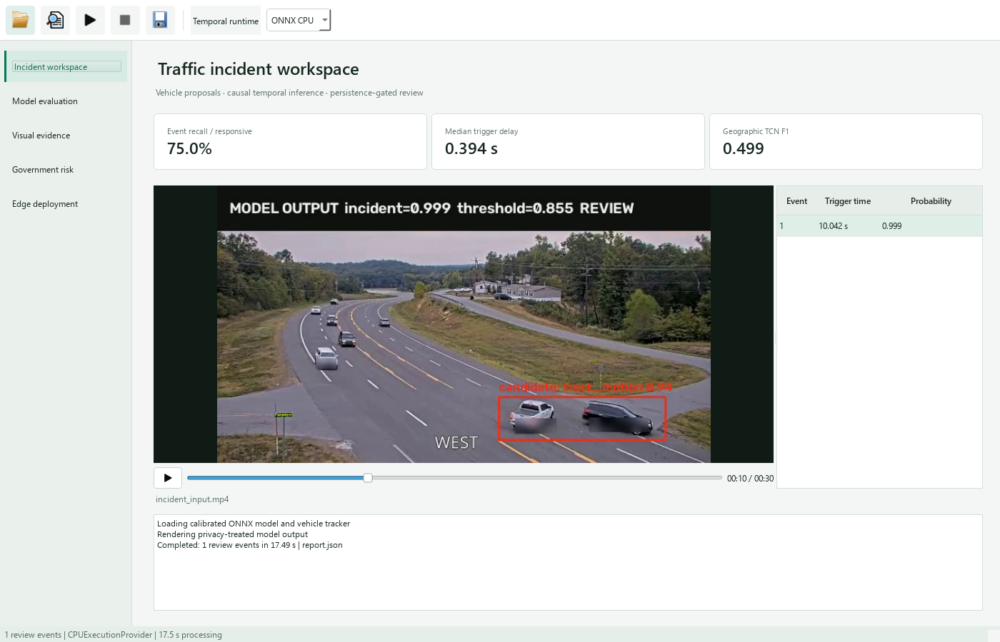
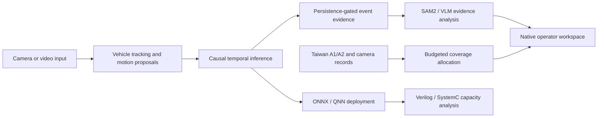
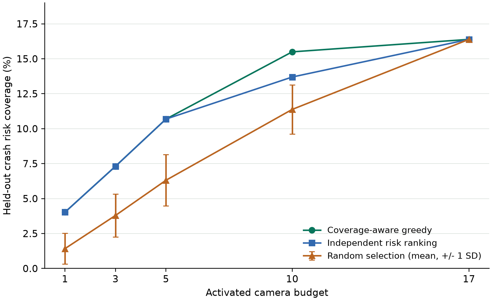
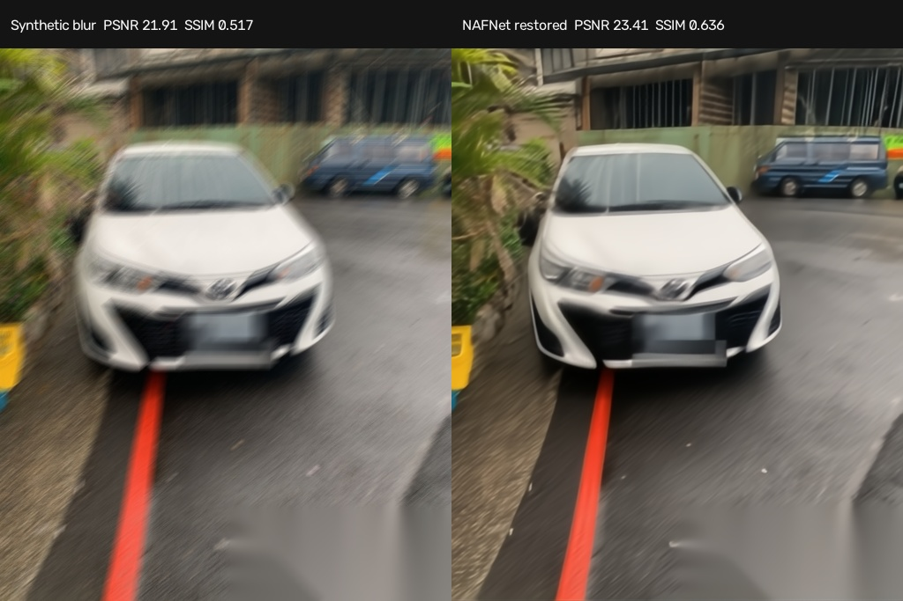

# solveillegalparkingbyVLM

## Risk-Aware Edge Intelligence for Traffic Incident Detection and Camera Allocation

This project develops a native desktop system for traffic-incident detection,
multimodal evidence analysis, and resource-constrained camera allocation.
Lightweight temporal inference connects visual incident evidence to public-sector
deployment priorities derived from Taiwan government crash and camera records.



[Native application walkthrough](docs/assets/desktop_walkthrough.mp4) ·
[Causal incident-model output](docs/assets/candidate_incident_model_output.mp4)

### Research Motivation

Roadside monitoring must balance timely incident recognition, nuisance alerts,
limited inference capacity, and uneven geographic risk. A visually accurate
model alone does not determine which cameras should receive scarce processing
resources or how evidence should reach an operator. The study therefore
examines perception, temporal decision-making, and deployment allocation within
a common evaluation framework.

The project originated in the 2025 Qualcomm Taiwan AI Hackathon. Red-line
parking remains its first rule-based event case. The current research extends
that foundation to temporal incident analysis and native laptop operation.
Team attribution and original demonstrations are retained in
[Project Provenance](docs/project_provenance.md).

### Research Contributions

1. **Causal incident-to-evidence processing.** Vehicle tracking and motion
   proposals feed a calibrated temporal convolutional model. Decisions retain
   their availability timestamps and generate privacy-treated review artifacts.
2. **Government-informed monitoring allocation.** A coverage-aware camera
   selection method uses historical A1/A2 crash demand and evaluates deployment
   choices on a subsequent temporal partition under matched camera budgets.
3. **Hardware-aware system evaluation.** Portable ONNX inference, explicit
   execution-provider selection, and Verilog/SystemC trace replay connect
   event quality to latency, queue pressure, and review capacity.

The methodological basis includes IEEE TCSVT, IEEE Communications Surveys &
Tutorials, IEEE T-ITS, Accident Analysis & Prevention, and Mathematical
Programming. The [literature matrix](docs/literature_basis.md) connects each
reference to an implemented method or experimental design.

### Native Desktop Application

```powershell
python -m venv .venv
.\.venv\Scripts\python.exe -m pip install -r Application/DebugVersion/requirements.txt -r requirements-desktop.txt
.\.venv\Scripts\python.exe -c "from ultralytics import YOLO; YOLO('yolov8n.pt')"
.\.venv\Scripts\python.exe scripts/run_desktop.py
```

The workbench provides video playback, asynchronous analysis, job cancellation,
event navigation, JSON export, model comparisons, visual evidence, government
risk analysis, and runtime diagnostics. A compact calibrated ONNX model and a
complete reference clip are included. The default interactive configuration
uses two CPU threads. Qualcomm QNN HTP is selectable when its execution provider
and target-compatible model are installed.

[Desktop architecture and deployment protocol](docs/desktop_application.md)

On Windows, `RunTrafficWorkbench.cmd` launches the installed native application.

### System Architecture



### Government-Data Study

New Taipei's 2024 crash records support an explicit temporal experiment:
January--September determines camera selection; October--December evaluates
the resulting geographic coverage. The study uses 46,957 dated A1/A2 records,
a fixed 17-camera inventory, three severity settings, three proximity radii,
five camera budgets, and 200 random seeds per randomized comparison.

At A1:A2 = 5:1 and a 1 km radius, ten-camera marginal-gain selection covers
**15.49%** of held-out crash risk, compared with **13.69%** for independent
ranking and **11.38%** for random selection. The improvement over independent
ranking is **1.80 percentage points**. Risk and count greedy achieve the same
coverage at this reference setting.

[Study protocol and interpretation](docs/government_camera_study.md) ·
[180-setting comparison](docs/results/government_camera_budget/comparison.csv) ·
[Source hashes and temporal partitions](docs/results/government_camera_budget/protocol.json)



### Incident Detection Results

| Split | Event profile | Test clips | Event recall | Median trigger delay | p95 delay |
| --- | --- | ---: | ---: | ---: | ---: |
| IID | Responsive | 100 | 0.750 | 0.394 s | 2.251 s |
| IID | Conservative | 100 | 0.440 | 0.608 s | 2.674 s |
| Geographic | Responsive | 100 | 0.630 | 0.625 s | 2.530 s |
| Geographic | Conservative | 100 | 0.300 | 1.057 s | 2.771 s |

Temporal-model comparisons use the same 500-clip cohort and grouped training
holdout calibration. At the calibrated operating point:

| Model | IID F1 | Geographic F1 | IID FPR | Geographic FPR |
| --- | ---: | ---: | ---: | ---: |
| Candidate ROI TCN | 0.473 | 0.499 | 0.235 | 0.304 |
| Frozen VideoMAE + linear head | 0.447 | 0.358 | 0.196 | 0.217 |
| Partial fine-tuned VideoMAE | 0.260 | 0.382 | 0.095 | 0.217 |

These endpoints characterize complementary operating choices. The
[evaluation report](docs/final_evaluation_report.md) specifies data partitions,
threshold selection, event matching, and review-load measurements.

The full-data extension processes all 2,027 input clips. Six clips are shorter
than the 32-frame eligibility requirement, leaving 2,021 clips and 3,387 windows.
Candidate/global TCNs share these windows and fixed training-holdout calibration:

| TCN features | IID F1 / FPR | Geographic F1 / FPR |
| --- | ---: | ---: |
| Candidate motion | 0.346 / 0.139 | 0.395 / 0.146 |
| Global motion | 0.521 / 0.290 | 0.357 / 0.131 |

This extension has a different class and geographic composition from the
balanced reference cohort. [Verified full-cohort results](docs/results/full_cohort_temporal.json)
include fitting, calibration, and test counts, model hashes, and exclusion records.

### Multimodal Evidence and Restoration


SAM2 refines difficult spatial candidates; VLMs produce structured evidence
reviews. The same-sample SAM2 study compares proposal recall and processing
cost. Clean-blind VLM cases examine schema validity and visual grounding.

In a paired 20-sequence study with matched greedy decoding, Qwen2.5-VL-3B
achieves 100% schema validity and 70% correct structured outputs across all
cases; LLaVA/Qwen-0.5B achieves 40% and 30%. Mean review times are 8.27 s and
7.76 s. The native workbench exports
event-specific temporal evidence and can attach Qwen review results directly.
Temporal/visual disagreement retains the event for operator inspection.
An eight-frame evidence-density ablation produces 60% correct structured
outputs at 10.12 s per review, compared with 70% at 8.27 s for three frames.
The paired protocol isolates evidence density from clip selection and decoding.



The official NAFNet REDS model improves PSNR from 21.91 to 23.41 dB and SSIM
from 0.517 to 0.636 under the specified motion-blur protocol. SM3Det contributes
a documented RGB/SAR/infrared transfer-analysis branch, with its original
architecture and computation requirements recorded in the
[transfer audit](docs/assets/sm3det_transfer_audit.json).

### Edge and Hardware Results

| Component | Measurement |
| --- | --- |
| TCN ONNX parity | 128 samples; maximum absolute error 1.79e-7 |
| QNN A16W8 preparation | 450 test windows; 100% float32 decision agreement; probability MAE 0.00201 |
| Native CPU reference analysis | Complete 30-second clip; one review event |
| Verilog | Three self-checking trigger testbenches passed |
| SystemC / Python trace parity | 49,320 frames, 6,808 candidates, 2,156 completed reviews |
| Four-camera workload | Zero frame drops at 7.5 FPS per camera |
| Review-stage pressure | 68.33% candidate drops at the 300 ms review-stage setting |
| Measured Qwen service-time scenario | 96.96% candidate drops; 8.27 s per review on four replicated streams |
| Capacity-aware review routing | Five Python/SystemC policy replays agree on all frame/review counters |

Causal overlap merging consolidates 6,808 proposal arrivals into 1,568 requests.
At the measured service budget, admission control completes 198 reviews with
zero queue overflow, three pending requests, and 1,367 explicit budget denials.
[Routing protocol and complete accounting](docs/review_routing_study.md)

The Qualcomm deployment workflow records the requested provider and enforces
explicit HTP execution. Target profiling is documented in the
[desktop deployment protocol](docs/desktop_application.md).

### Reproduction

```powershell
python scripts/evaluate_government_camera_budget.py
python scripts/run_desktop.py --analyze --screenshot docs/assets/desktop_workbench.png
python -m pytest
```

Government inputs are prepared using `scripts/prepare_taiwan_data.py` and the
versioned dataset-source manifest. Large training data and experiment outputs
remain under `data/raw/`, `data/processed/`, and `outputs/`. The optional
browser-based result viewer remains available with `scripts/run_project_dashboard.py`.

### Research Artifacts

- [Methodological foundations](docs/literature_basis.md)
- [Manuscript structure and research questions](docs/manuscript_outline.md)
- [Government camera allocation study](docs/government_camera_study.md)
- [Formal evaluation report](docs/final_evaluation_report.md)
- [Native desktop application](docs/desktop_application.md)
- [Project status](docs/project_status.md) and [development tasks](docs/todo.md)
- [Hardware simulation](hardware_sim/README.md)
- [Capacity-aware evidence routing](docs/review_routing_study.md)

### Attribution and Licensing

The original contributors are 蔡霆鋒, 辛語柔, and 周佳欣. Contact information
and original system figures are retained in [Project Provenance](docs/project_provenance.md).
Project source code uses the MIT license. ACCIDENT media and the bundled
research model use CC BY-NC-SA 4.0; upstream models and figures retain their
respective licenses. See [media attribution](docs/assets/README.md) and
[model-bundle provenance](Application/desktop/models/README.md).
