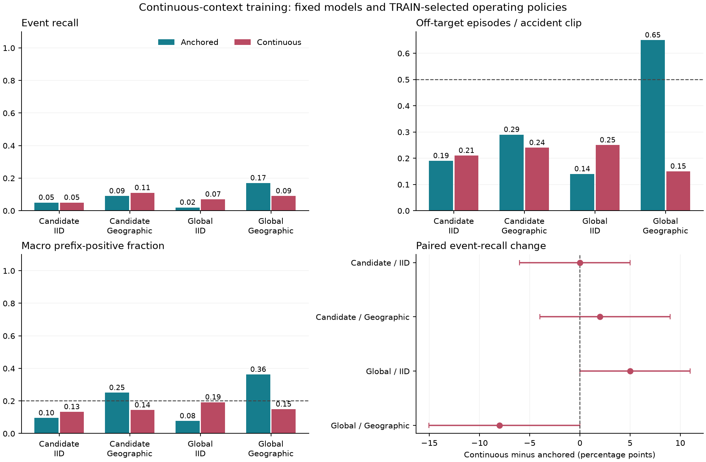
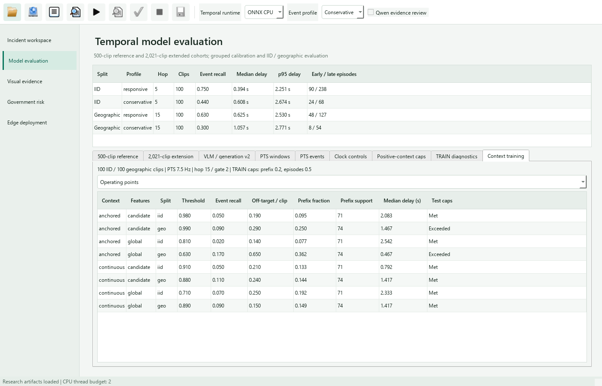

# Continuous-Context Training Alignment

## Rationale

The TRAIN-only event-local diagnostic identifies weak within-source score
ranking and insufficient adjacent target-positive decisions under constrained
thresholds. The training comparison therefore examines the alignment of
training contexts with continuous inference, retaining the existing TCN
architecture and candidate/global feature definitions as controls.

Before extracting features or fitting models, a fit-only feasibility audit
fixes its source membership and physical-time label definitions. It inherits
the grouped fit partitions from the paired presentation study; calibration and
test identities cannot enter a split's fit audit. A source that belongs to fit
in only one split contributes only to that split's summaries.

## Predeclared Support Audit

The inference grid remains 7.5 Hz, with 16 distinct images, 15 motion steps
and hop 15. Lateness bounds and missing-context rejection use the immutable
presentation helpers. Relative to the supplied annotation's verified PTS:

- Prefix: decision endpoint strictly before event time minus one second.
- Target: decision endpoint in the inclusive interval [event minus one,
  event plus three seconds].
- Post: later endpoints, counted but excluded from proposed binary fitting.

These are annotation-relative supervision labels, not independently reviewed
visual-state labels or normal-camera observations. Every fit source remains in
the support denominator, including sources with no valid contexts or without
both classes. No predictions, score ranking or test endpoints are read.

Predeclared outputs include source/context counts, both-class support,
one-window and two-window structural reachability, adjacent target-target
support, exact frame-identity overlap with inherited fixed-time anchored
contexts, and inherited-label versus endpoint-label disagreements. Packet
timestamps and media hashes must match the parent audit. Expanded-context
decoder verification remains mandatory before feature extraction.

```powershell
python scripts/audit_continuous_training_support.py freeze
# Commit the protocol before computing support endpoints.
python scripts/audit_continuous_training_support.py run
python -m pytest tests/test_incident_training_support.py
```

## Training Gate

The support audit is not a fitted-model comparison. A subsequent immutable
protocol must specify exact fit/calibration/test membership, settings,
class/clip weighting, stopping rules, calibration objective and evaluation
endpoints before extraction or fitting. Compare fixed-time annotation-anchored
training with continuous-grid training under the same spatial and inference
contract. This changes context phase and supervision jointly, not architecture
alone. Any video-representation arm must share the same source/context/label
contract. Previously used TRAIN calibration rows are development data; earlier
window-test observations remain disclosed. Existing reference binaries and
operating defaults remain unchanged.

## Completed Fit-Support Audit

The protocol was committed as `98d364a` before computing the new endpoints.
All 557 distinct fit-union sources match the parent video and packet-PTS
hashes. The public inventory retains every corresponding fit source.

| Fit partition | IID | Geographic |
| --- | ---: | ---: |
| Source clips | 376 | 332 |
| Valid continuous contexts | 2,894 | 1,535 |
| Rejected contexts | 89 | 91 |
| Prefix / target / post contexts | 511 / 705 / 1,678 | 392 / 586 / 557 |
| Sources with both fitting classes | 237 | 186 |
| Gate-1 structural support | 375 | 330 |
| Gate-2 structural support | 337 | 282 |
| Adjacent target-target support | 322 | 255 |
| Anchored contexts | 572 | 496 |
| Exact anchored/continuous frame matches | 43 | 44 |

There are no empty-context sources in these fit partitions. No inherited
anchored labels disagree with the declared endpoint labels; the audit does
not identify mislabeled examples. Instead, it documents different context
phase and sampling support. Excluding post-event contexts leaves 1,216 IID
and 978 geographic binary-fitting contexts, without adding source clips.
This establishes feasibility, not improved recognition or deployment recall.
The complete training comparison and expanded-context decoder validation
remain subsequent gates.

[Frozen support protocol](results/continuous_training_support_protocol.json) ·
[Split summaries](results/continuous_training_support.json) ·
[557-source inventory](results/continuous_training_support.csv) ·
[3,830 fit-union contexts](results/continuous_training_support_contexts.csv).

## Frozen Model Comparison

The [training protocol](results/continuous_training_protocol.json) now fixes
eight anchored/continuous by candidate/global by IID/geographic TCN fits.
The corresponding 376/94 and 332/83 fit/calibration partitions are unchanged.
Both arms use 32 channels, dropout 0.1, 40 epochs, batch size 64, AdamW at
0.001 with weight decay 0.0001, seed 42, fit-only standardization and the
same class-weighted binary loss. The final epoch is retained without
calibration-driven checkpoint selection. Context counts and phase change
jointly; equal epochs do not imply equal optimization steps or training cost.

Each new event test cohort contains 100 clips, with a 190-source union, and
excludes 654 identities from prior event replays and holdouts. Selection is a
deterministic source-name hash, not score-dependent sampling. Previously
observed window-test results are explicitly acknowledged. All eight models
must be fitted before training-holdout event calibration; every operating
policy must then be frozen before test replay. Calibration fixes the 0.5
off-target episode budget and 0.2 macro prefix-positive cap, with the declared
tie order and unsupported-source handling. All four paired recall contrasts,
budget exceedances and constant controls will be reported.

The [2,633-row fitting manifest](results/continuous_training_protocol.jsonl)
contains only each source's corresponding fit memberships. Execution workers
and their hash-bound appendix were tested and committed before real extraction
or fitting. All eight fits and 808 TRAIN calibration points are complete;
commit `b934615` fixes every policy before the new event-test replay.

## Execution Appendix

The new execution workers leave all earlier study implementations unchanged.
Fixture tests exercise exact threshold tie-breaking, unsupported populations,
partition leakage rejection, finite feature tensors, smoke-data exclusion,
final-epoch reproducibility and the complete eight-model publisher. A
synthetic end-to-end publication retains an empty test source and verifies
every checkpoint probability against its stored tensor.

The execution freeze records two common-fit smoke sources, runtime and tool
versions, code hashes and permitted cache reuse. Parent fixed-time anchored
features and the existing continuous TRAIN-calibration tensors may be reused
only after hash, runtime and context-identity checks. Old model scores are not
used. Continuous fitting and new event-test tensors are generated separately.
Reused and newly extracted feature costs remain distinct.

```powershell
python scripts/freeze_continuous_context_execution.py
# Commit the execution appendix before real jobs.
python scripts/run_continuous_context_study.py smoke --device cpu
python scripts/run_continuous_context_study.py verify-fit
python scripts/run_continuous_context_study.py extract-fit
python scripts/run_continuous_context_study.py fit
python scripts/run_continuous_context_study.py calibrate
# Preserve all TRAIN-only selected policies before test replay.
python scripts/run_continuous_context_study.py test
python scripts/publish_continuous_context_study.py
```

All expanded fitting-frame identities must pass the decoder audit before
complete extraction or fitting. Failed sources remain in the audit and halt
the study rather than changing its cohort. Every new checkpoint's embedded
0.5 threshold is explicitly an unselected placeholder; only the separately
frozen training-holdout selection defines operating policies. Reference
desktop models are not replaced.

### Decoder Gate and Cost Contracts

The complete fitting decoder gate passes **27,986 selected frames** from
557 sources and all 2,633 manifest contexts, with zero failed sources. The
full audit is retained under `outputs/accident/continuous_context/`; its SHA256
is `6c0d7a2605ae5f8c8688eb945a4bbad3ebf5d44733c7641ec1b77dbd0549d212`.

Separate contracts, fixed before new model results, specify temporal-only
CPU latency and integer-controller verification. All models receive the same
first context from ten supported TRAIN-calibration sources. Twenty warm-up
calls precede 1,000 timed batch-one calls per model, with two CPU threads.
The benchmark includes standardization but excludes detection, decoding,
networking, queueing and VLM review. It runs after the extraction/replay jobs.

The new hardware check applies the original UNORM16 encoder, Python golden
controller and Icarus testbench to all selected calibration/test streams. It
counts float/integer positive, review, episode, event and trigger-time changes,
including empty sources and gap resets. It does not assume quantization parity
or claim NPU arithmetic, synthesized timing or target power.

[CPU timing contract](results/continuous_context_latency_protocol.json) ·
[New-score controller contract](results/continuous_context_rtl_protocol.json).

## Historical-Control Reproducibility

The four newly fitted anchored controls retain exactly the historical fit-row
order, labels and feature values. They are not bitwise checkpoint replicas.
Changing channel/source indexing order changes NumPy strides and float32
reduction order: the maximum fit-mean difference is 5.72e-6 and the maximum
fit-scale difference is 1.91e-6. Final parameter differences reach 0.1099--0.1642
across the four models. These are measured numerical differences, not evidence
of changed labels or test leakage, and the audit does not attribute the full
optimization difference to a single cause.

The new study compares both training arms through one frozen worker and leaves
all historical weights and results untouched. Paired intervals condition on
one fitted seed and the selected calibration policies; they do not quantify
optimization-seed uncertainty. Future multi-seed work should fix contiguous
reduction conventions before fitting rather than changing this completed run.

[Checkpoint comparison](results/continuous_context_anchor_replication.json) ·
[FIT-only identity and layout audit](results/continuous_context_anchor_inputs.json).

## Completed Event Comparison

The 190-source test union is complete, with 100 corresponding clips per
split and no replacements. All 26,232 calibration/test probabilities reproduce
exactly from the eight fitted checkpoints and saved tensors. Test prefix
support is 71/100 IID and 74/100 geographic clips, comprising 157/175 contexts;
the remaining 29/26 clips stay in event-recall denominators. The common grid
rejects 36/33 contexts, with no empty-context test sources.

| Training contexts | Features | Split | Threshold | Event recall | Off-target / clip | Macro prefix-positive | Test caps |
| --- | --- | --- | ---: | ---: | ---: | ---: | --- |
| Anchored | Candidate | IID | 0.98 | 0.05 | 0.19 | 0.095 | Met |
| Anchored | Candidate | Geographic | 0.99 | 0.09 | 0.29 | 0.250 | Prefix exceeded |
| Anchored | Global | IID | 0.81 | 0.02 | 0.14 | 0.077 | Met |
| Anchored | Global | Geographic | 0.63 | 0.17 | 0.65 | 0.362 | Both exceeded |
| Continuous | Candidate | IID | 0.91 | 0.05 | 0.21 | 0.133 | Met |
| Continuous | Candidate | Geographic | 0.88 | 0.11 | 0.24 | 0.144 | Met |
| Continuous | Global | IID | 0.71 | 0.07 | 0.25 | 0.192 | Met |
| Continuous | Global | Geographic | 0.89 | 0.09 | 0.15 | 0.149 | Met |

All four continuous-context policies meet both test caps, compared with two
of four anchored policies. This descriptive feasibility result accompanies
low sensitivity, not a uniform recognition improvement. Continuous-minus-
anchored recall changes are 0 pp [-6, 5] and +2 pp [-4, 9] for candidate IID
and geographic testing, and +5 pp [0, 11] and -8 pp [-15.025, 0] for global
testing. Every pointwise 95% interval contains zero. These intervals condition
on the fitted seed and TRAIN-selected policies, without multiplicity correction.

The clock-only positive controls attain recall 0.54/0.58, but exceed the
prefix cap with fraction 1.0 and the episode cap with 0.55/0.53 episodes per
clip. Always-negative controls meet both caps with zero recall. Thus neither
raw recall nor cap compliance alone establishes a useful detector. Prefix
labels remain annotation-relative accident-clip labels, not independently
reviewed normal-camera exposure.



[Complete results and model hashes](results/continuous_context_results.json) ·
[Operating points and signed delays](results/continuous_context_results.csv) ·
[Public context scores](results/continuous_context_scores.csv) ·
[Complete source inventory](results/continuous_context_inventory.csv) ·
[Per-clip outcomes](results/continuous_context_outcomes.csv) ·
[All 808 calibration points](results/continuous_context_calibration.csv).

The separate public-data auditor reconstructs all 808 calibration points,
eight selections, 1,200 model/control outcomes and four paired intervals from
13,740 assigned context scores and 1,508 model/source inventory rows, without
video or checkpoint access. Six rehashed corruption cases test semantic
checks beyond checksum validation. The ninth native model-evaluation tab
shows operating points, paired intervals and temporal costs without changing
the reference deployment selection.

```powershell
python scripts/export_context_inventory.py
python scripts/audit_continuous_contexts.py
python scripts/benchmark_context_models.py run
python scripts/verify_context_score_rtl.py verify
python scripts/plot_continuous_context_study.py
```

Commands that create immutable outputs reject overwrites; the reconstruction
function can be rerun through the public regression tests. See the
[independent audit](results/continuous_context_audit.json).

## Measured Execution and Controller Parity

The predeclared CPU benchmark measures 1,000 batch-one calls per model after
20 warm-up calls, using the same ten TRAIN contexts and two CPU threads.
Median temporal inference is 0.962--0.985 ms and p95 is 1.194--1.335 ms.
Raw timings are retained. This measures standardization and the TCN, separately
from image decoding, detector/tracker features, network delivery and VLM service.
Run order is fixed and operating-system activity is not controlled; small
between-model differences should not be interpreted as architectural speedups.

All 13,740 corresponding confidence decisions across 1,508 model/source runs
expand to 29,124 checked RTL cycles. Icarus and the integer golden controller
have zero mismatches. UNORM16 maximum observed probability error is 7.62916e-6,
with zero observed changes in positive/review flags, episode pulses, event
detection or trigger time. The pre-existing near-threshold counterexample
remains part of the tests, so this is trace-conditional parity. The contribution
verifies post-inference control and preserves the separate SystemC queue studies;
it does not measure accelerator computation, synthesized timing or device power.

[Raw CPU timing study](results/continuous_context_latency.json) ·
[New-model RTL verification](results/continuous_context_rtl.json).



## Next Research Contract

The present comparison does not justify replacing the reference model.
A subsequent video-representation comparison should use the same continuous
source/context/label contract, with settings and calibration objectives frozen
before fitting. Multi-seed optimization and independently reviewed normal
camera-hours address different uncertainties and should be reported separately.
