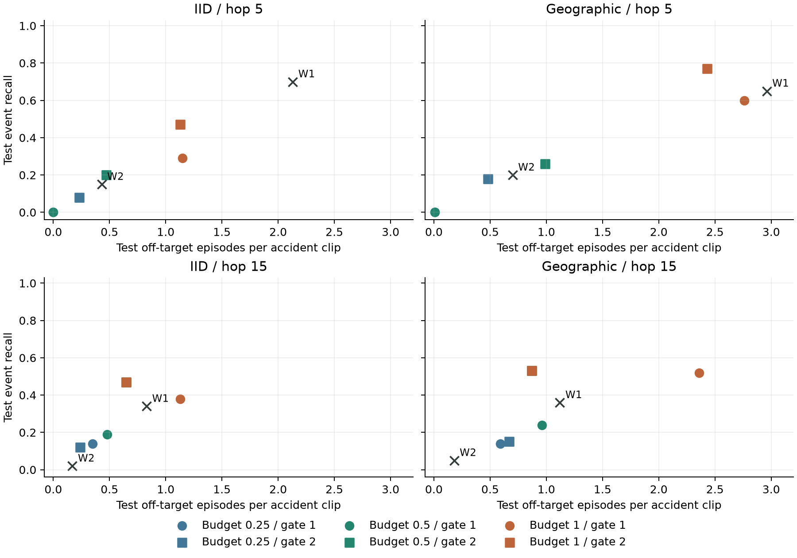

# Training-Holdout Calibration of Continuous Event Decisions

## Rationale

Model fitting and operational decision rules are separate estimation problems.
The decision threshold governs the tradeoff between event recall and alert
demand. This distinction follows Fawcett's discussion of operating conditions
in *An Introduction to ROC Analysis*, Pattern Recognition Letters 27(8),
861--874 (2006), [DOI: 10.1016/j.patrec.2005.10.010](https://doi.org/10.1016/j.patrec.2005.10.010).
The [scikit-learn threshold-selection guidance](https://scikit-learn.org/stable/modules/classification_threshold.html)
likewise separates fitted scores from application decisions and requires
independent data for threshold tuning.

The implementation adapts this principle to causal alert episodes rather than
independent frame labels. It does not use sklearn's binary-window optimizer
as a substitute for temporal event scoring.

## Frozen Protocol

The verified full-cohort candidate TCNs are fixed. Their original grouped
training partitions are reconstructed from the hashed sequence archive and
training seed. The IID model has 402 fitting and 101 calibration clips; the
geographic model has 359 fitting and 90 calibration clips. Neither calibration
set overlaps its model-fitting or official test clips.

The protocol fixes source-downsampled feature width at 320, display width at
640, target cadence at 7.5 Hz, and sequence length at 15 feature steps. Dense
inference uses five-step hops; 15-step decisions are obtained by selecting the
corresponding existing windows and recomputing persistence. Decision times use
the sampled source-frame index divided by container FPS, rather than an
average resampled-playback timestamp. This is a frame-index clock, not decoded
presentation time. The [presentation-clock audit](cadence_source_audit.md)
keeps these timing contracts distinct; legacy measurements remain unchanged.

For each one/two-window persistence gate and five/15-step hop, evaluate the
threshold grid 0.00, 0.01, ..., 1.00 plus the model's original window-calibrated
threshold. Select the maximum calibration event recall subject to 0.25, 0.5,
or 1.0 off-target episodes per clip. Ties favor fewer off-target episodes,
then a higher threshold. Infeasible budgets remain unselected.

An off-target episode starts outside the existing accident-matching interval
of one second before to three seconds after the annotated event. Accident
clips are event-enriched: this endpoint is not a normal-camera false-alarm
rate and does not estimate traffic incident prevalence.

[Frozen cohorts, source hashes, and selection rules](results/continuous_event_calibration_protocol.json)

## Execution Order and Verification

For each split, the queue performs calibration inference, writes an immutable
threshold selection, then runs the fixed 100-clip test selection. Test execution
requires the selection file and records its hash. Evaluation checks that the
selection predates test inference. Model, metadata, implementation, batch, and
per-clip report hashes bind every stage to its inputs. All declared budgets,
gates, and hops are reported, including negative or infeasible findings.

The test report compares selected thresholds with the same full-cohort model's
original window threshold. Paired source-clip intervals condition on the fitted
model and selected threshold; they do not resample calibration-set selection.
The 500-clip desktop model, original evaluation tables, and deployment defaults
remain unchanged.

```powershell
python scripts/prepare_event_calibration_protocol.py
python scripts/run_overnight_research.py --phase calibration --deadline 2026-10-17T04:00:00+00:00
python -m pytest tests/test_incident_event_calibration.py tests/test_continuous_calibration_cli.py tests/test_overnight_research.py
```

## Test Results

The protocol was committed at `83a9ff8` before continuous-event inference.
All eight queue stages completed with selection preceding test
inference and all provenance checks satisfied. The table shows the predeclared
0.5-episode budget at hop 15; all 24 settings are retained in the linked tables.

| Split | Gate | Threshold | Calibration off-target/clip | Test recall | Test off-target/clip | Median delay (s) | Recall difference from window threshold (95% interval) |
| --- | ---: | ---: | ---: | ---: | ---: | ---: | --- |
| IID | 1 | 0.98 | 0.406 | 0.19 | 0.48 | 0.797 | -0.15 (-0.23, -0.08) |
| IID | 2 | 0.03 | 0.495 | 0.47 | 0.65 | 0.842 | +0.45 (+0.35, +0.55) |
| Geographic | 1 | 0.95 | 0.389 | 0.24 | 0.96 | 0.962 | -0.12 (-0.19, -0.06) |
| Geographic | 2 | 0.04 | 0.389 | 0.53 | 0.87 | 0.946 | +0.48 (+0.38, +0.58) |

The corresponding original full-cohort window thresholds give hop-15 recall
0.34/0.02 for IID gates 1/2 and 0.36/0.05 for geographic gates 1/2. Event-level
selection changes the persistence tradeoff substantially. Five of twelve IID
settings and nine of twelve geographic settings exceed their nominal
calibration budget on test clips. Thresholds of 1.00 selected under tight
hop-five/gate-one budgets yield zero test recall. This is a substantive
operating constraint, not a missing result.

Neither off-target episode count nor episode-level recall must vary monotonically
with threshold: changing a threshold can split or merge positive runs and move
an episode's first alert outside the matching interval. Test budget exceedance
therefore motivates explicit demand monitoring and new, independently reviewed
normal exposure rather than a test-selected threshold replacement. Conditional
delay describes detected events only. The two test cohorts overlap in source
clips and are not pooled as independent replications.



Circles/squares denote persistence gates 1/2; crosses W1/W2 denote the original
window threshold for the corresponding gate. Coincident selected settings
overlap. Colors identify calibration budgets, not achieved test budgets.

[IID complete table](results/continuous_event_calibration_iid.csv) ·
[Geographic complete table](results/continuous_event_calibration_geographic.csv) ·
[IID provenance and intervals](results/continuous_event_calibration_iid.json) ·
[Geographic provenance and intervals](results/continuous_event_calibration_geographic.json)

```powershell
python scripts/plot_continuous_event_calibration.py
```
