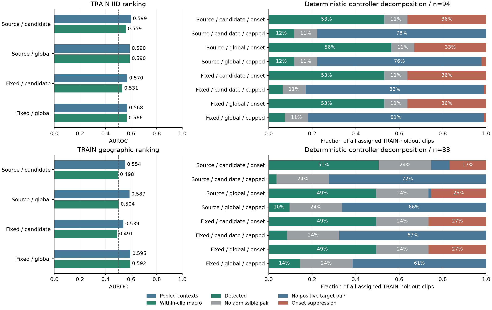

# Training-Holdout Event-Local Diagnostics

## Question and Scope

The constrained replay reveals a sensitivity/workload tradeoff, but does not
identify its mechanism. This diagnostic separates annotation-relative score
ranking, physical-time support, positive-pair persistence and episode-onset
suppression. It retains all eight models and uses only each model's existing
official-TRAIN calibration clips: 94 IID and 83 geographic sources.

The protocol is specified after earlier window/event outcomes were observed.
These calibration clips have already informed threshold selection. The new
endpoints are therefore exploratory development diagnostics, not an untouched
test or a replacement for published evaluations. No model is fitted, reversed,
selected or promoted to a new native default.

## Input Freeze

Before computing any new endpoint, export calibration-only inventory and score
CSVs from the hash-bound public context traces. Preserve every assigned clip,
including clips without valid contexts. Freeze source membership, model hashes,
annotation endpoints, score-file hashes, runtime versions, endpoint definitions,
two inherited operating policies and all paired contrasts. A separate execution
appendix will bind the diagnostic implementation before real-data analysis.
Test rows do not enter these derived inputs or the analysis reader.

## Ranking Endpoints

For a supplied event PTS `a`, contexts ending before `a-1` are prefix negatives.
Contexts ending in the inclusive interval `[a-1, a+3]` are annotation-relative
targets. Later contexts are counted and summarized, but excluded from this
ranking task. These endpoint labels are not independent visual frame labels.

Report pooled AUROC and noninterpolated average precision (AP), target
prevalence and AP minus prevalence. Separately compute each metric within
clips containing both labels and average equally over supported clips. Disclose
all unsupported populations; do not give them invented zero metrics. Within
each supported clip, also summarize maximum target minus maximum prefix score.
Larger model scores always mean target; unfavorable rankings are not inverted.

Precision-recall analysis accompanies AUROC because its interpretation depends
on the positive fraction. The methodological source is [Saito and Rehmsmeier,
PLOS ONE 10(3), e0118432 (2015)](https://doi.org/10.1371/journal.pone.0118432),
whose authors, date and article metadata were verified against the publisher.
AP follows the [scikit-learn definition](https://scikit-learn.org/stable/modules/generated/sklearn.metrics.average_precision_score.html),
not trapezoidal PR-curve integration. A constant-score control uses the same
contexts and exposes the prevalence baseline without claiming visual skill.

## Timing and Controller Diagnostics

The one-context structural diagnostic asks whether any valid endpoint falls
inside the target band. The two-context diagnostic additionally requires an
immediately preceding valid hop-15 context. This is an annotation-aided timing
upper bound, ignoring both score quality and operating caps. It is not an
implementable recognition policy.

For both previously selected thresholds, classify every calibration clip into
one mutually exclusive category, in this order:

1. Detected: a two-positive episode onset ends within the target band.
2. Structurally unreachable: no admissible adjacent pair can end in that band.
3. No target positive pair: the grid supports detection, but the thresholded
   scores never form an adjacent positive pair ending in the band.
4. Onset suppression: such a pair exists, but sustained positivity emitted
   its episode before the target band and never re-armed inside it.

All clips remain in the denominator. Missing hops reset persistence. This
decomposition attributes deterministic score/controller behavior, not unseen
visual causes or real-world normal-camera false alarms.

## Paired Reporting

Compare fixed-time minus source-frame training for candidate/global features
and IID/geographic models, on identical supported source identities. Report
eight pointwise contrasts: four within-clip AUROC and four within-clip AP
differences, with 2,000 source-clip percentile bootstrap resamples, seed 42.
Keep both signs, class/support counts and conditional uncertainty. No new test
scores or test-driven hyperparameters enter this diagnostic.

## Completed Findings

Protocol `2859dc658d2a7ce390780094722be975b4db3c27c5fca9c461724b58c37db45c`
and the separate execution appendix were committed before real-data analysis.
The input contains **708 model-assigned calibration clips and 4,464 scores**;
no test rows enter the worker. The original **94/83** source denominators and
all eight existing model hashes remain unchanged.

| Model / split | Pooled AUROC | Within-clip AUROC | Within-clip AP | Supported clips |
| --- | ---: | ---: | ---: | ---: |
| Source-frame candidate / IID | 0.599 | 0.559 | 0.738 | 59 |
| Source-frame global / IID | 0.590 | 0.590 | 0.754 | 59 |
| Source-frame candidate / geographic | 0.554 | 0.498 | 0.703 | 40 |
| Source-frame global / geographic | 0.587 | 0.504 | 0.695 | 40 |
| Fixed-time candidate / IID | 0.570 | 0.531 | 0.708 | 59 |
| Fixed-time global / IID | 0.568 | 0.566 | 0.746 | 59 |
| Fixed-time candidate / geographic | 0.539 | 0.491 | 0.678 | 40 |
| Fixed-time global / geographic | 0.595 | 0.592 | 0.735 | 40 |

The pooled target fractions are **0.607/0.611**; equal-supported-clip target
fractions are **0.529/0.507**. AP values therefore require their task and
prevalence context. Constant-score AP equals prevalence, but random-order
expected AP need not equal that constant baseline in short samples. With one
positive and one negative, the two untied rank orders have AP 1 and 0.5, whose
mean is 0.75, whereas tied constant scores yield 0.5. AP minus prevalence is
reported as a reference contrast, not a chance-corrected significance test.

Within-clip AUROC ranges from **0.491 to 0.592**, compared with pooled values
0.539--0.599. These distinct estimands reveal limited event-local ordering
under the retained representation and endpoint labels. Fixed-minus-source
AUROC differences are -0.028/-0.024 for IID candidate/global and -0.007/+0.089
for geographic candidate/global. Every one of the eight paired AUROC/AP
intervals includes zero; the positive geographic-global point contrast does
not establish a consistently superior training policy.

One-context timing support is **94/94 IID** and **82/83 geographic**. Requiring
an adjacent prior context reduces structural attainability to **84/94** and
**63/83**. The one empty geographic clip remains in its assigned denominator.
This annotation-aided bound ignores recognition and operating constraints.

| Model / split | Capped detections | Structurally unreachable | No target positive pair | Onset suppression |
| --- | ---: | ---: | ---: | ---: |
| Source-frame candidate / IID | 11 | 10 | 73 | 0 |
| Source-frame global / IID | 11 | 10 | 71 | 2 |
| Source-frame candidate / geographic | 3 | 20 | 60 | 0 |
| Source-frame global / geographic | 8 | 20 | 55 | 0 |
| Fixed-time candidate / IID | 6 | 10 | 77 | 1 |
| Fixed-time global / IID | 7 | 10 | 76 | 1 |
| Fixed-time candidate / geographic | 7 | 20 | 56 | 0 |
| Fixed-time global / geographic | 12 | 20 | 51 | 0 |

At onset-only thresholds, suppression accounts for **31--34 IID** and
**14--22 geographic** clips per model. At constrained thresholds, only 0--2
clips per model fail this way; **71--77 IID** and **51--60 geographic** clips
instead lack a qualifying positive pair. Re-arming the controller alone
therefore cannot explain or repair most constrained misses. This is a
deterministic diagnostic, not proof of which visual cues are absent.



## Verification and Next Experiment

Public tests reconstruct every supported clip's AUROC through direct positive-
negative pair comparisons and AP through tied threshold groups. Every policy's
detection is also compared against the frozen production PTS evaluator. All
eight constrained detection counts match their earlier training-only selection
records. Empty/unsupported clips, test-row rejection, gap resets, orientation,
ties and chronology have explicit regression coverage.

The native diagnostic view separates ranking, all sixteen controller outcomes
and eight paired intervals. These are TRAIN-only development measurements,
not new final-test scores.

```powershell
python -m pytest tests/test_event_discrimination.py tests/test_event_discrimination_public.py tests/test_desktop_event_diagnostics.py
python scripts/plot_event_discrimination.py
python scripts/run_desktop.py --page 1 --tab 7 --screenshot outputs/train_diagnostics.png
```

Subsequent work should first freeze a continuous-context training comparison:
retain source-level fit/calibration partitions, physical-time inference and
controller semantics, and compare inherited annotation-anchored training with
training contexts drawn from the actual continuous PTS grid. Introduce a video
representation only under the same context/label contract. Audit fit-only class
support and freeze fitting/calibration settings before extraction or training.
The present diagnostics motivate that experiment without selecting a model
from observed test scores or forecasting improved accuracy.

[Frozen protocol](results/event_discrimination_protocol.json) ·
[Execution appendix](results/event_discrimination_execution.json) ·
[All model summaries and paired contrasts](results/event_discrimination_results.json) ·
[708 per-clip diagnostic outcomes](results/event_discrimination_outcomes.csv).
