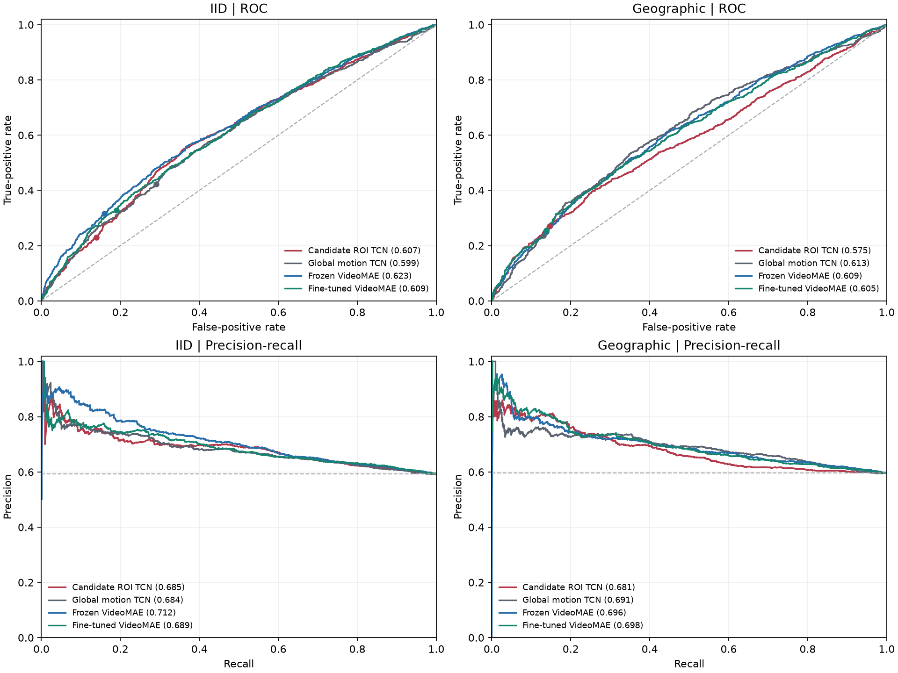

# Traffic Incident Detection and Risk-Aware Deployment: Evaluation Report

## 1. Study Design

The evaluation connects candidate generation, temporal incident recognition,
multimodal evidence analysis, normal-stream monitoring, and constrained edge
deployment. ACCIDENT provides fixed-CCTV incident video. Taiwan government
records support camera allocation and geographic risk analysis. The native
desktop application integrates inference and artifact inspection.

The [methodological literature matrix](literature_basis.md) documents the
relationship between prior work and the experimental design.

## 2. Event Recall and Trigger Delay

The IID evaluation contains 100 test clips, balanced across five collision
types. Inference uses vehicle tracking, motion proposals, and a causal TCN.
Accident timing annotations enter the post-inference evaluator. Decisions are
assigned to the end of each input window. Event matching uses a one-second
early and three-second late tolerance.

| Profile | Consecutive positive windows | Recall | Mean delay | Median delay | p95 delay | Early / late episodes |
| --- | ---: | ---: | ---: | ---: | ---: | ---: |
| Responsive | 1 | 0.750 | 0.546 s | 0.394 s | 2.251 s | 90 / 238 |
| Conservative | 2 | 0.440 | 0.689 s | 0.608 s | 2.674 s | 24 / 68 |

Responsive recall ranges from 0.60 for head-on collisions to 0.95 for rear-end
collisions. Persistence reduces off-target episodes and lowers recall. These
results motivate operating-point selection based on the monitoring objective
and available review capacity. Data: [event metrics](results/accident_event_metrics.csv).

Clip-level 95% Wilson intervals are 0.657--0.825 for the responsive profile and
0.347--0.538 for the conservative profile. The interval calculation is retained
in [the uncertainty artifact](results/research_uncertainty.json).

The geographic evaluation uses its corresponding geographically trained model
and 100 stratified test clips (sampling seed 42), with zero inference failures.
Responsive recall is 0.630 (95% Wilson interval 0.532--0.718), median delay
0.625 s, and p95 delay 2.530 s. Conservative recall is 0.300 (0.219--0.396),
median delay 1.057 s, and p95 2.771 s. Early/late episode counts are 48/127 and
8/54, respectively. The batch completes in 1,305.4 s on the local GPU workflow.

[Geographic protocol, per-type results, and per-clip decisions](results/geographic_event_evaluation.json)

### 2.1 Spatial and Decision-Hop Audit

The original IID event batch uses five-step decision hops; geographic and
desktop replay use 15-step hops. A separate matched audit aligns both spatial
protocols to 15-step hops by selecting existing IID640 window probabilities
and recomputing persistence. On this common grid, IID responsive recall is
0.48 at 640 pixels and 0.50 at 320 pixels; conservative recall is 0.20/0.08.
Geographic responsive recall is 0.63/0.47 and conservative recall 0.30/0.20.
The audit preserves all original results and reports paired clip intervals.
These findings motivate train-only continuous-event calibration under an
explicit spatial/cadence/hop contract.

Data: [preprocessing study](spatial_preprocessing_study.md),
[paired numerical artifact](results/event_resolution_audit.json).

## 3. Temporal-Model Comparison

Candidate ROI TCN, frozen VideoMAE, and partial fine-tuned VideoMAE use the same
500 clips, temporal windows, and IID/geographic partitions. Operating thresholds
are selected on a clip-grouped training holdout with a target window FPR of
0.20. The test partition remains separate from calibration.

| Model | IID F1 / FPR | Geographic F1 / FPR |
| --- | ---: | ---: |
| Candidate ROI TCN | 0.473 / 0.235 | 0.499 / 0.304 |
| Frozen VideoMAE + linear head | 0.447 / 0.196 | 0.358 / 0.217 |
| Partial fine-tuned VideoMAE | 0.260 / 0.095 | 0.382 / 0.217 |

Partial fine-tuning updates the final encoder block using learning rates of
1e-5 for the encoder and 1e-3 for the head, class-weighted loss, and holdout
early stopping. Selected IID and geographic checkpoints occur at epochs
3 and 10. At threshold 0.5, IID F1 is 0.746 with FPR 0.860; the calibrated
comparison identifies the recall/false-positive tradeoff under the specified
monitoring budget. TCN serves as the compact trigger and frozen VideoMAE as a
complementary video representation.

Data: [matched-cohort comparison](results/model_fair_comparison.csv).

### 3.1 Full-Cohort Extension

All 2,027 source clips are processed without extraction failures. Six clips
have fewer than 32 frames and therefore contribute no eligible window. The
remaining 2,021 clips produce 3,387 windows. IID partitions contain 503 training
and 1,518 test clips; geographic partitions contain 449 training and 1,572 test
clips. Grouped calibration reserves 101 and 90 training clips, respectively.

| TCN features | IID F1 / FPR | Geographic F1 / FPR |
| --- | ---: | ---: |
| Candidate motion | 0.346 / 0.139 | 0.395 / 0.146 |
| Global motion | 0.521 / 0.290 | 0.357 / 0.131 |
| Frozen VideoMAE | 0.444 / 0.159 | 0.373 / 0.138 |
| Fine-tuned VideoMAE | 0.450 / 0.190 | 0.378 / 0.138 |

Each TCN is trained for 40 epochs with seed 42, 32 channels, and dropout 0.1.
Calibration targets a training-holdout FPR of 0.20. Candidate features improve
geographic F1 relative to global motion, while global motion has higher IID
recall and F1 at a higher test FPR. Training/calibration behavior and changed
cohort composition motivate regularization and cadence-controlled analysis.
The 500-clip reference model remains unchanged in the desktop bundle.

The publisher reconstructs all test metrics from stored predictions, verifies
exact test-set membership and targets, and records source/model hashes.
Data: [full-cohort temporal study](results/full_cohort_temporal.json).

The matched VideoMAE extension uses all eligible windows. Fine-tuning updates
1,776,002 parameters, including the final encoder block, with the existing
1e-5 encoder and 1e-3 head learning rates. Grouped-holdout early stopping
selects epochs 3 and 5 for IID and geographic training, respectively.

| Representation | IID AUROC / AP | Geographic AUROC / AP |
| --- | ---: | ---: |
| Candidate ROI TCN | 0.607 / 0.685 | 0.575 / 0.681 |
| Global motion TCN | 0.599 / 0.684 | 0.613 / 0.691 |
| Frozen VideoMAE | 0.623 / 0.712 | 0.609 / 0.696 |
| Fine-tuned VideoMAE | 0.609 / 0.689 | 0.605 / 0.698 |

AP uses the recall-weighted precision definition implemented by scikit-learn.
Positive-window prevalence is 0.593 for IID and 0.596 for geographic evaluation.
Thresholds remain fixed from the training holdout; the test curves characterize
ranking behavior across operating points.

A paired source-clip bootstrap with 2,000 resamples estimates fine-tuned minus
frozen F1 differences of 0.0062 (95% interval -0.0223 to 0.0341) for IID and
0.0054 (-0.0192 to 0.0289) for geographic evaluation. Candidate minus global
differences are -0.1746 (-0.2054 to -0.1425) and 0.0378 (0.0074 to 0.0689),
respectively, at their separately calibrated thresholds. Resampling captures
test-clip variation conditional on fixed trained models and thresholds.

Colored ROC markers denote the training-calibrated operating points. Dashed
lines show random-ranking ROC behavior and the positive-prevalence PR baseline.

Data: [eight-model comparison](results/full_cohort_model_comparison.csv),
[hashes, protocols, and paired estimates](results/full_cohort_model_comparison.json).

## 4. Spatial Evidence and Multimodal Review

On ten matched clips, SAM2.1-t increases proposal recall at IoU 0.1 from 0.667
to 0.680. Recall at IoU 0.3 is 0.453 for both methods. Processing time changes
from 10.855 to 37.213 seconds, supporting selective spatial evidence refinement.

Qwen2.5-VL-3B produces schema-valid review JSON with model context. Its
clean-blind case misses the distant collision. LLaVA/Qwen-0.5B mentions a
collision but produces invalid schema and an unsupported traffic-light
description. The measured role of VLM review is structured summarization and
evidence inspection; the expanded paired evaluation below characterizes visual
grounding and operator-review outcomes.

Data: [SAM2/VLM study](results/sam2_vlm_ablation.csv).

The generation-contract version-2 replication explicitly forwards sampling
parameters to model generation and pins the original revisions. On the same
twenty paired sequences, Qwen three-frame schema validity is 95%, all-case
structured correctness 60%, and mean service 8.533 s. LLaVA yields 40%, 30%,
and 7.692 s. Their paired correctness difference is +30 percentage points
(95% source-clip bootstrap: +10 to +50). Qwen with eight frames yields 95%
schema validity and 55% all-case correctness at 9.736 s; the eight-minus-three
contrast is -5 points (-25 to +15). The source clip is the bootstrap unit;
ten source clips are not treated as twenty independent sequences.
[Corrected comparisons and provenance](vlm_generation_contract.md#corrected-paired-results).

The following retained runs document the requested-decoding implementation
before the runtime audit; their original results and service measurements
remain available for versioned comparison.

An expanded paired study evaluates ten IID test clips, each contributing a
collision sequence and a pre-event sequence. Both models receive identical
privacy-treated frames, a collision-specific prompt, and a 192-token budget.
Labels derive from ACCIDENT event timestamps and remain separate from requests.
The preserved run requests `do_sample=False` and seed 42. A subsequent
[runtime audit](vlm_generation_contract.md) identifies that the top-level
sampling argument reaches preprocessing, not generation, in Transformers
5.13.0. These results retain their original artifact names but do not establish
a verified common greedy decoder. Explicitly forwarded replications are
recorded separately without overwriting these observations.

| Model | Cases | Schema validity | Correct structured outputs / all cases | Mean review time |
| --- | ---: | ---: | ---: | ---: |
| Qwen2.5-VL-3B | 20 | 100% | 70% | 8.27 s |
| LLaVA/Qwen-0.5B | 20 | 40% | 30% | 7.76 s |

Qwen's schema-valid confusion matrix is TP=6, FP=2, FN=4, TN=8. LLaVA's is
TP=0, FP=0, FN=2, TN=6. Reporting all-case structured correctness accounts for
schema failures; valid-case accuracy alone would favor selective subsets.
The paired sequences are clustered within ten source clips.

Data: [Qwen greedy batch](results/incident_vlm_qwen_greedy_batch.json),
[LLaVA greedy batch](results/incident_vlm_llava_greedy_batch.json). Earlier
upstream-decoding runs are retained separately as
[Qwen replication](results/incident_vlm_qwen_batch.json) and
[LLaVA replication](results/incident_vlm_llava_batch.json).

An eight-frame Qwen ablation preserves the same clips, positive/negative
interval endpoints, prompt, requested generation settings, and token budget. Schema validity
is 95%, all-case structured correctness is 60%, and mean service time is
10.123 s. The valid-case confusion matrix is TP=3, FP=1, FN=6, TN=9. Relative
to three frames, denser sampling does not improve this small paired cohort;
temporal localization and evidence selection remain separate design factors.
The protocol was specified in [ADR 004](decisions/004-temporal-evidence-density.md).

Data: [eight-frame ablation](results/incident_vlm_qwen_dense8_greedy_batch.json).

Evidence-aware disposition additionally honors the VLM's evidence gaps and
operator-review request. In the preserved Qwen cohort, confidence-only
support accepts eight sequences (six positive, two negative). All eight
declare evidence gaps and are therefore unresolved under the complete-evidence
policy. Twelve other sequences produce temporal/visual disagreement. Raw
classification remains 14/20 correct; selective support precision is undefined
when no cases are supported. [Review-routing analysis](vlm_evidence_routing.md)
separates these endpoints and preserves every temporal event.

## 5. Government CCTV Monitoring

A Taichung public-CCTV endpoint was sampled for 300.26 seconds, yielding 252
frames at an effective 0.837 FPS. Repeated endpoint images account for 63.1%
of samples. Contact-sheet inspection identified normal traffic. Across the
two recorded sessions, 21 windows cover 0.0867 camera-hours. Three raw positive
windows produce zero persistence-gated alert episodes. The one-sided 95%
Poisson exposure bound is 34.55 alerts per camera-hour. Additional exposure
will tighten that interval and characterize site-to-site variation.

Data: [deployment measurements](results/deployment_metrics.json).

### 5.1 Persistent Camera Ingestion

The native observation workflow was subsequently verified against the same
Taichung public-camera page using persistent MJPEG transport. A 30.03-second
capture preserves 218 frames at 7.283 FPS, with one connection, zero read
failures, and zero exact duplicate frames. A separate native end-to-end run
preserves 223 frames at 7.446 FPS and completes CPU analysis in 17.613 s,
producing zero review events. These observations retain their annotation status
separately from the normal-exposure cohort above.

The application previews acquisition, preserves source-frame timestamps,
verifies the captured-video hash, and maps exported events back to observation
time. Acquisition precedes batch analysis in this workflow; the subsequent
continuous implementation is documented in [ADR 005](decisions/005-observation-clock-and-live-inference.md).

Data: [native camera observations](results/native_cctv_observations.json).

## 6. Edge Runtime and Hardware Evaluation

Three Icarus Verilog testbenches validate dwell logic, bounding-box overlap,
and motion triggering. SystemC 3.0.2 replays 12,330 real candidate-trace records
replicated across four camera streams. Python and SystemC agree on 49,320
processed frames, zero frame drops, 6,808 candidates, 2,156 completed reviews,
and 4,652 review drops. The current finite-arrival generator uses an explicit
frame count to align simulation boundaries with the Python workload.

The four-camera configuration uses 7.5 FPS per camera and a 300 ms review
stage. Its 68.33% candidate-drop rate identifies downstream review as the
capacity bottleneck. The temporal ONNX graph passes checker validation and
128-sample parity with a maximum absolute difference of 1.79e-7.

Replacing the configured review service time with Qwen's measured mean of
8.274 s produces 198 completed reviews, nine pending candidates, and 6,601
dropped candidates (96.96%) from the same 6,808 proposals. Frame drops remain
zero. This trace-replay scenario isolates review-stage capacity: proposal
arrivals are replicated across four streams, detector/temporal service costs
remain configured, and the review worker uses a constant measured mean. It
concatenates sampled benchmark windows at a nominal 7.5 FPS; the workload
therefore represents sampled proposal demand rather than traffic prevalence. It
motivates event deduplication and budgeted review routing rather than sending
every proposal to a VLM.

Data: [measured review-service scenario](results/measured_review_queue.json).

Five routing-policy replays preserve complete proposal accounting. Causal
overlap merging consolidates 5,240 of 6,808 proposal arrivals. At full measured
service capacity, merging plus strict token-bucket admission yields 198
completed reviews, three pending requests, 1,367 budget denials, and zero queue
drops. Four-camera admissions are 51/50/50/50. The 80% budget yields 161
completed reviews and one pending request. All eight frame/review counters
match between Python and SystemC 3.0.2 in every policy.

Data: [routing study](review_routing_study.md),
[five-policy artifact](results/review_routing.json).

A separate 24-condition replay uses TCN-gated episodes from the 100-clip IID
and geographic event batches. All integer queue counters reproduce in SystemC.
The IID single-camera conservative profile completes matching reviews for all
44 detected events without metering, but only 30 under full-capacity admission.
The four-camera responsive IID profile instead improves from 51 to 62 completed
matched events under metering. Queue overflow, admission denial, and event
retention therefore require distinct endpoints. Immediate edge notification is
separated from downstream evidence-service admission in the native streaming
implementation. Data: [TCN event-retention replay](review_routing_study.md#tcn-gated-event-retention).

The continuous native pipeline maintains a one-frame acquisition mailbox,
15-step feature buffer, and 16-frame evidence ring. Sequential reference-video
inference matches batch decisions on all 14 windows, with a maximum probability
difference of 1.79e-7. A 30-second Taichung camera session processes 202 frames
at 6.74 FPS and measures 98/135 ms median/p95 decoder-arrival-to-decision time.
Its two review episodes remain unlabeled and are not added to the reviewed
normal-exposure cohort. [Streaming protocol](streaming_inference.md) records
the clock boundary, resource limits, and reproducible validation.

The subsequent observation workflow saves a full model-unmarked sampled-video
track and append-only reviewer records. Source-report/video hashes bind labels
to observations. The normal-exposure evaluator excludes uncertain, incomplete,
model-informed and conflicting records, counts duplicate media once, and
removes source-clock gaps above one second. Distinct inference contracts are
not pooled. One-sided Poisson upper bounds remain conditional on stationary
arrival assumptions. Acquisition and VLM triage alone add no reviewed normal
camera-hours. [Observation-review protocol](observation_review_protocol.md).

QNN preparation fixes the input to `(1, 15, 10)` and calibrates A16W8 QDQ using
128 training windows from 112 clips. Calibration/test clip overlap is zero.
On 450 test windows, probability MAE is 0.00201 and decisions match float32 on
all windows at the unchanged threshold. The graph uses ONNX opset 21.
Data: [quantization protocol and results](results/qnn_quantization.json).

The native application executes ONNX inference in a separate worker and
records provider configuration, model hash, and processing duration. QNN HTP
uses explicit provider selection and disabled CPU fallback. Hardware-specific
profiling follows the target protocol in [desktop_application.md](desktop_application.md).

## 7. Government-Informed Camera Allocation

The expanded allocation experiment uses all 46,957 dated New Taipei A1/A2
records. January--September supplies historical demand; October--December
provides temporal holdout. Coordinate validation retains 34,106 training and
12,846 holdout records. The fixed inventory contains 17 camera sites.

At A1:A2 = 5:1, radius 1 km, and budget ten, marginal-gain camera selection
achieves 15.49% held-out risk coverage. Independent ranking achieves 13.69%;
the mean of 200 random selections is 11.38%. Risk and count greedy are equal
at this setting. The full 180-row experiment varies severity weights, radius,
and budget. These endpoints measure allocation efficiency and geographic
proximity; site visibility is assessed separately.

A paired district bootstrap over 29 districts and 2,000 resamples estimates
the greedy-minus-independent difference as 1.80 percentage points, with a 95%
interval of -1.01 to 5.64 points. The coverage curve and sensitivity table
describe allocation behavior across budgets and neighborhoods.

The earlier descriptive top-risk-grid analysis yields 10.75%, 18.95%, and
24.84% risk coverage within 500 m, 1 km, and 2 km using the complete inventory.
Its denominator differs from the all-record temporal allocation study.

The Taoyuan violation analysis uses 309,493 records. Its intervention-cost
scenario assumes a 35% reduction at high-ranked locations and yields monthly
net savings of NTD 149,467. Scenario parameters remain explicit for subsequent
longitudinal evaluation of observed operational effects.

Data: [temporal allocation study](government_camera_study.md),
[descriptive integration](assets/government_risk_integration.json).

## 8. Research Implications

The [temporal source audit](cadence_source_audit.md) distinguishes nominal
frame-index timing from presentation timestamps before cadence-controlled
training. All 2,027 media inputs are hashed; seven train-only decoded traces
show nominal-clock deviations up to 1.36 s. Existing event results retain their
original clock contract. Presentation-time sampling and label-frame support
define the separate controlled extension. Its completed paired-window study
retains 1,861 clips and 2,985 windows. Fixed-time candidate F1 improves by
3.64 pp on IID testing [0.35, 6.64], with increased FPR; the geographic
contrast is +1.09 pp [-1.94, 4.39]. Global F1 declines by 6.68 and 8.24 pp.
The [complete comparison](presentation_time_protocol.md) retains ranking
metrics, all eight model hashes and pointwise source-clip intervals. Its
[continuous PTS follow-up](presentation_event_protocol.md) uses a separate
common-clock, training-calibrated event contract.

Continuous-event calibration uses 101 IID and 90 geographic held-out training
clips under a frozen 320-pixel, 7.5-Hz, source-clock protocol. All 24 operating
settings are evaluated on separate 100-clip test batches after threshold
selection. At hop 15 and a calibration budget of 0.5 off-target episodes/clip,
two-window recall changes from 0.02 to 0.47 (IID) and 0.05 to 0.53 (geographic).
Test off-target demand is 0.65 and 0.87 episodes/clip, exceeding that budget.
One-window recall instead decreases from 0.34 to 0.19 and 0.36 to 0.24.
Five of twelve IID and nine of twelve geographic settings exceed their
calibration budgets. These results preserve the full tradeoff rather than
selecting a replacement default from test scores.
[Complete calibration study](continuous_event_calibration.md).

Review-service sensitivity replaces constant mean service with source-bound
empirical draws from twenty measured Qwen durations in 176 scenarios. All 32
constant/first-assignment SystemC comparisons agree on eight integer counters.
For four-camera responsive metered replay, p95 completion latency changes from
32.96 to a median of 39.06 s (IID) and 32.95 to 36.91 s (geographic). Matched
event completions remain 62 and 78 in those conditions. Assignment ranges are
not population confidence intervals. [Service study](review_service_variability.md).

The system establishes an auditable connection between incident timing,
evidence generation, compute capacity, and public-sector allocation. The
government-data study demonstrates the value of accounting for redundant
camera coverage under a fixed budget. The native implementation makes these
results inspectable alongside executable video inference. Subsequent work
extends cadence-consistent temporal training, normal-stream exposure,
multimodal evidence routing, and target-device profiling.
