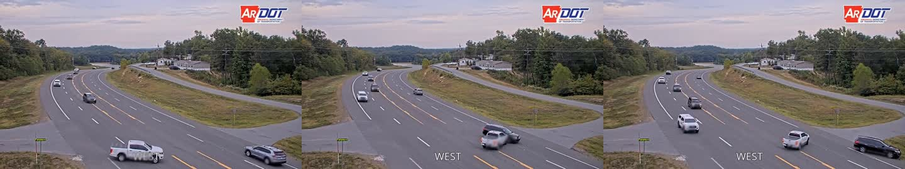

# Traffic Incident Detection and Risk-Aware Deployment: Evaluation Report

## 1. Study Design

The evaluation connects candidate generation, temporal incident recognition,
multimodal evidence analysis, normal-stream monitoring, and constrained edge
deployment. ACCIDENT provides fixed-CCTV incident video. Taiwan government
records support camera allocation and geographic risk analysis. The native
desktop application integrates inference and artifact inspection.

The [methodological literature matrix](literature_basis.md) documents the
relationship between prior work and the experimental design.

## 2. Event Recall and Trigger Delay

The IID evaluation contains 100 test clips, balanced across five collision
types. Inference uses vehicle tracking, motion proposals, and a causal TCN.
Accident timing annotations enter the post-inference evaluator. Decisions are
assigned to the end of each input window. Event matching uses a one-second
early and three-second late tolerance.

| Profile | Consecutive positive windows | Recall | Mean delay | Median delay | p95 delay | Early / late episodes |
| --- | ---: | ---: | ---: | ---: | ---: | ---: |
| Responsive | 1 | 0.750 | 0.546 s | 0.394 s | 2.251 s | 90 / 238 |
| Conservative | 2 | 0.440 | 0.689 s | 0.608 s | 2.674 s | 24 / 68 |

Responsive recall ranges from 0.60 for head-on collisions to 0.95 for rear-end
collisions. Persistence reduces off-target episodes and lowers recall. These
results motivate operating-point selection based on the monitoring objective
and available review capacity. Data: [event metrics](results/accident_event_metrics.csv).

Clip-level 95% Wilson intervals are 0.657--0.825 for the responsive profile and
0.347--0.538 for the conservative profile. The interval calculation is retained
in [the uncertainty artifact](results/research_uncertainty.json).

The geographic evaluation uses its corresponding geographically trained model
and 100 stratified test clips (sampling seed 42), with zero inference failures.
Responsive recall is 0.630 (95% Wilson interval 0.532--0.718), median delay
0.625 s, and p95 delay 2.530 s. Conservative recall is 0.300 (0.219--0.396),
median delay 1.057 s, and p95 2.771 s. Early/late episode counts are 48/127 and
8/54, respectively. The batch completes in 1,305.4 s on the local GPU workflow.

[Geographic protocol, per-type results, and per-clip decisions](results/geographic_event_evaluation.json)

## 3. Temporal-Model Comparison

Candidate ROI TCN, frozen VideoMAE, and partial fine-tuned VideoMAE use the same
500 clips, temporal windows, and IID/geographic partitions. Operating thresholds
are selected on a clip-grouped training holdout with a target window FPR of
0.20. The test partition remains separate from calibration.

| Model | IID F1 / FPR | Geographic F1 / FPR |
| --- | ---: | ---: |
| Candidate ROI TCN | 0.473 / 0.235 | 0.499 / 0.304 |
| Frozen VideoMAE + linear head | 0.447 / 0.196 | 0.358 / 0.217 |
| Partial fine-tuned VideoMAE | 0.260 / 0.095 | 0.382 / 0.217 |

Partial fine-tuning updates the final encoder block using learning rates of
1e-5 for the encoder and 1e-3 for the head, class-weighted loss, and holdout
early stopping. Selected IID and geographic checkpoints occur at epochs
3 and 10. At threshold 0.5, IID F1 is 0.746 with FPR 0.860; the calibrated
comparison identifies the recall/false-positive tradeoff under the specified
monitoring budget. TCN serves as the compact trigger and frozen VideoMAE as a
complementary video representation.

Data: [matched-cohort comparison](results/model_fair_comparison.csv).

## 4. Spatial Evidence and Multimodal Review

On ten matched clips, SAM2.1-t increases proposal recall at IoU 0.1 from 0.667
to 0.680. Recall at IoU 0.3 is 0.453 for both methods. Processing time changes
from 10.855 to 37.213 seconds, supporting selective spatial evidence refinement.

Qwen2.5-VL-3B produces schema-valid review JSON with model context. Its
clean-blind case misses the distant collision. LLaVA/Qwen-0.5B mentions a
collision but produces invalid schema and an unsupported traffic-light
description. The measured role of VLM review is structured summarization and
evidence inspection; the expanded paired evaluation below characterizes visual
grounding and operator-review outcomes.

Data: [SAM2/VLM study](results/sam2_vlm_ablation.csv).

An expanded paired study evaluates ten IID test clips, each contributing a
collision sequence and a pre-event sequence. Both models receive identical
privacy-treated frames, a collision-specific prompt, and a 192-token budget.
Labels derive from ACCIDENT event timestamps and remain separate from requests.
The controlled comparison uses greedy decoding (`do_sample=False`) and seed 42.

| Model | Cases | Schema validity | Correct structured outputs / all cases | Mean review time |
| --- | ---: | ---: | ---: | ---: |
| Qwen2.5-VL-3B | 20 | 100% | 70% | 8.27 s |
| LLaVA/Qwen-0.5B | 20 | 40% | 30% | 7.76 s |

Qwen's schema-valid confusion matrix is TP=6, FP=2, FN=4, TN=8. LLaVA's is
TP=0, FP=0, FN=2, TN=6. Reporting all-case structured correctness accounts for
schema failures; valid-case accuracy alone would favor selective subsets.
The paired sequences are clustered within ten source clips.

Data: [Qwen greedy batch](results/incident_vlm_qwen_greedy_batch.json),
[LLaVA greedy batch](results/incident_vlm_llava_greedy_batch.json). Earlier
upstream-decoding runs are retained separately as
[Qwen replication](results/incident_vlm_qwen_batch.json) and
[LLaVA replication](results/incident_vlm_llava_batch.json).

An eight-frame Qwen ablation preserves the same clips, positive/negative
interval endpoints, prompt, greedy decoding, and token budget. Schema validity
is 95%, all-case structured correctness is 60%, and mean service time is
10.123 s. The valid-case confusion matrix is TP=3, FP=1, FN=6, TN=9. Relative
to three frames, denser sampling does not improve this small paired cohort;
temporal localization and evidence selection remain separate design factors.
The protocol was specified in [ADR 004](decisions/004-temporal-evidence-density.md).

Data: [eight-frame ablation](results/incident_vlm_qwen_dense8_greedy_batch.json).

## 5. Government CCTV Monitoring

A Taichung public-CCTV endpoint was sampled for 300.26 seconds, yielding 252
frames at an effective 0.837 FPS. Repeated endpoint images account for 63.1%
of samples. Contact-sheet inspection identified normal traffic. Across the
two recorded sessions, 21 windows cover 0.0867 camera-hours. Three raw positive
windows produce zero persistence-gated alert episodes. The one-sided 95%
Poisson exposure bound is 34.55 alerts per camera-hour. Additional exposure
will tighten that interval and characterize site-to-site variation.

Data: [deployment measurements](results/deployment_metrics.json).

## 6. Edge Runtime and Hardware Evaluation

Three Icarus Verilog testbenches validate dwell logic, bounding-box overlap,
and motion triggering. SystemC 3.0.2 replays 12,330 real candidate-trace records
replicated across four camera streams. Python and SystemC agree on 49,320
processed frames, zero frame drops, 6,808 candidates, 2,156 completed reviews,
and 4,652 review drops. Four pending arrivals at the SystemC endpoint reflect
event-boundary accounting.

The four-camera configuration uses 7.5 FPS per camera and a 300 ms review
stage. Its 68.33% candidate-drop rate identifies downstream review as the
capacity bottleneck. The temporal ONNX graph passes checker validation and
128-sample parity with a maximum absolute difference of 1.79e-7.

Replacing the configured review service time with Qwen's measured mean of
8.274 s produces 198 completed reviews, nine pending candidates, and 6,601
dropped candidates (96.96%) from the same 6,808 proposals. Frame drops remain
zero. This trace-replay scenario isolates review-stage capacity: proposal
arrivals are replicated across four streams, detector/temporal service costs
remain configured, and the review worker uses a constant measured mean. It
concatenates sampled benchmark windows at a nominal 7.5 FPS; the workload
therefore represents sampled proposal demand rather than traffic prevalence. It
motivates event deduplication and budgeted review routing rather than sending
every proposal to a VLM.

Data: [measured review-service scenario](results/measured_review_queue.json).

QNN preparation fixes the input to `(1, 15, 10)` and calibrates A16W8 QDQ using
128 training windows from 112 clips. Calibration/test clip overlap is zero.
On 450 test windows, probability MAE is 0.00201 and decisions match float32 on
all windows at the unchanged threshold. The graph uses ONNX opset 21.
Data: [quantization protocol and results](results/qnn_quantization.json).

The native application executes ONNX inference in a separate worker and
records provider configuration, model hash, and processing duration. QNN HTP
uses explicit provider selection and disabled CPU fallback. Hardware-specific
profiling follows the target protocol in [desktop_application.md](desktop_application.md).

## 7. Government-Informed Camera Allocation

The expanded allocation experiment uses all 46,957 dated New Taipei A1/A2
records. January--September supplies historical demand; October--December
provides temporal holdout. Coordinate validation retains 34,106 training and
12,846 holdout records. The fixed inventory contains 17 camera sites.

At A1:A2 = 5:1, radius 1 km, and budget ten, marginal-gain camera selection
achieves 15.49% held-out risk coverage. Independent ranking achieves 13.69%;
the mean of 200 random selections is 11.38%. Risk and count greedy are equal
at this setting. The full 180-row experiment varies severity weights, radius,
and budget. These endpoints measure allocation efficiency and geographic
proximity; site visibility is assessed separately.

A paired district bootstrap over 29 districts and 2,000 resamples estimates
the greedy-minus-independent difference as 1.80 percentage points, with a 95%
interval of -1.01 to 5.64 points. The coverage curve and sensitivity table
describe allocation behavior across budgets and neighborhoods.

The earlier descriptive top-risk-grid analysis yields 10.75%, 18.95%, and
24.84% risk coverage within 500 m, 1 km, and 2 km using the complete inventory.
Its denominator differs from the all-record temporal allocation study.

The Taoyuan violation analysis uses 309,493 records. Its intervention-cost
scenario assumes a 35% reduction at high-ranked locations and yields monthly
net savings of NTD 149,467. Scenario parameters remain explicit for subsequent
longitudinal evaluation of observed operational effects.

Data: [temporal allocation study](government_camera_study.md),
[descriptive integration](assets/government_risk_integration.json).

## 8. Research Implications

The system establishes an auditable connection between incident timing,
evidence generation, compute capacity, and public-sector allocation. The
government-data study demonstrates the value of accounting for redundant
camera coverage under a fixed budget. The native implementation makes these
results inspectable alongside executable video inference. Subsequent work
extends cadence-consistent temporal training, normal-stream exposure,
multimodal evidence routing, and target-device profiling.
