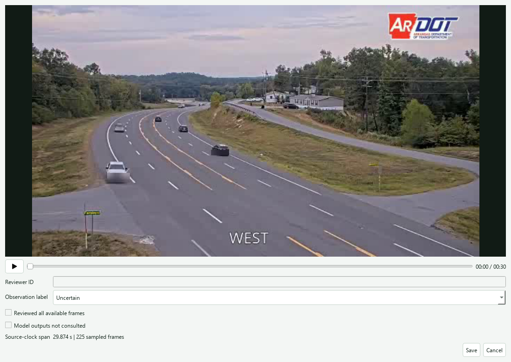

# Source-Clock Observation Review and Normal Exposure

## Review Unit and Separation

A continuous observation supplies two synchronized sampled-frame videos:
privacy-treated model playback and privacy-treated clean playback. The latter
excludes added model boxes, probability text, event state, and artificial
timestamp overlays. The clean video and original frame timestamps are hashed
in the source report. Earlier reports without this complete clean recording
are not retroactively promoted to blinded observation records.

The earlier 0.0867-camera-hour contact-sheet-screened pilot retains its original
protocol and result. It is not retrospectively certified by this new workflow
or pooled into its reviewer-attested exposure cohort.

The native annotation dialog opens only clean playback. The default label is
`uncertain`; complete viewing and non-consultation of model outputs are separate,
unchecked reviewer attestations. Reviewer identity is mandatory. Saving writes
a new annotation file and does not modify the model report or infer a label
from VLM output. The attestations record the reviewer's declarations; the
application does not independently certify reviewer behavior or blindness.

## Exposure Contract

The fixed observation-gap limit is one second, specified before the additional
camera acquisition. Eligible elapsed time is the sum of adjacent source-clock
intervals no greater than that limit. Larger gaps and the unobserved interval
before the first or after the last sampled frame contribute no exposure.
Playback duration at 7.5 FPS is not substituted for source-clock exposure.
The limit defines an acquisition-coverage rule, not continuous visibility
between every pair of frames.

The initial 120-second acquisition request terminated after 30.303 s with a
source-read failure; its original record is retained. The subsequent transport
protocol allows three consecutive reconnect attempts, with interruptible
0.25/0.5/1-second backoff. A successful frame resets the consecutive-failure
budget. Source indices and decoder observation time remain monotonic across
connections. The main worker polls the mailbox every 0.5 s so duration and
cancellation checks continue while reconnecting.

When adjacent sampled frames differ by more than one second, motion features,
tracker state and persistence are reset. Pending event evidence is finalized
with the last available pre-gap image and marked truncated. A new causal
window requires fresh post-gap features; no artificial frames or continuous
exposure are inserted across the interruption. Gap records and reconnect
counters accompany subsequent acquisition reports.

Primary normal exposure requires label `normal`, complete available-frame review,
and a declaration that model outputs were not consulted. Uncertain, incomplete,
and model-informed records are excluded. Contradictory eligible labels exclude
the observation pending resolution. Duplicate clean-video hashes contribute
once, regardless of reviewer count. Confirmed incident observations and local
file replay do not contribute normal camera-hours. Different model, detector,
feature-width, hop, persistence, or threshold contracts are evaluated separately.

The numerator counts temporal alert episodes whose source trigger lies within
an eligible normal interval. The endpoint does not substitute VLM classifications
or raw positive windows for alert episodes. Report review coverage, camera-hours,
episode count, and the observed rate together.

## Rate Uncertainty

For count n and eligible exposure T in hours, the one-sided 95% Poisson upper
limit is `chi2.ppf(0.95, 2*(n+1)) / (2*T)`. At n = 0 this reduces to
`-log(0.05)/T`. Zero eligible exposure yields undefined rate and upper limit,
not a zero-error result. The construction follows the count-interval treatment
of [Garwood, Biometrika 28(3--4), 437--442 (1936)](https://doi.org/10.1093/biomet/28.3-4.437).
Publisher metadata verifies the title, author, volume, pages and DOI.

The interval is conditional on stationary Poisson event arrivals. Traffic,
camera conditions and temporal dependence can violate that assumption; longer
multi-session evaluation should retain session/district strata and investigate
overdispersion. Label reliability and acquisition gaps are separate uncertainty
sources, not corrected by a count interval.

## Execution

Open a new continuous camera report in the native workbench and select the
observation annotation action. The clean-video dialog stores records under
`outputs/observation_reviews/`. Only an actual reviewer assigns labels.

```powershell
python scripts/evaluate_observation_reviews.py --review-glob "outputs/observation_reviews/*.json" --output outputs/validation/reviewed_normal_exposure.json
python scripts/publish_observation_inventory.py --report outputs/desktop/RUN_ID/report.json
python -m pytest tests/test_observation_review.py tests/test_streaming_integration.py tests/test_desktop_app.py
```

The acquisition inventory reports unassigned review status and zero added
normal exposure until reviewer records satisfy the protocol. Public numeric
artifacts do not redistribute public-camera imagery.

## Acquisition Results

The reconnect-enabled follow-up completes the 120-second request in 120.152 s,
with 861 sampled frames and 1,169 decoded frames. Acquisition records four
connections, four failed reads and four retry attempts across separate failure
bursts. The conservative reference emits four unassigned review episodes.
Median/p95 decoder-arrival-to-decision latency is 80.0/91.8 ms.

A 2.216-second sampled-frame gap near startup triggers a temporal reset.
The source span is 119.828 s; excluding this gap leaves 117.612 s of eligible
acquisition coverage before any label eligibility is considered. This gap may
reflect processing or acquisition behavior; it is not automatically attributed
to a transport outage. The first window decision becomes available 4.618 s
after the worker's observation-clock origin. This includes sequence warm-up
but not model initialization, which occurs before that origin. Subsequent
worker reports record initialization and total worker duration separately.

Both this follow-up and the earlier failed acquisition remain unassigned for
independent review. Neither zero alerts in the first observation nor four
alerts in the follow-up determines its true label. Their added reviewed-normal
exposure is zero. [Numeric acquisition inventory](results/review_ready_observations.json).



The screenshot uses the licensed reference clip to demonstrate the annotation
workflow. File replay is explicitly excluded from camera-hour evaluation.
