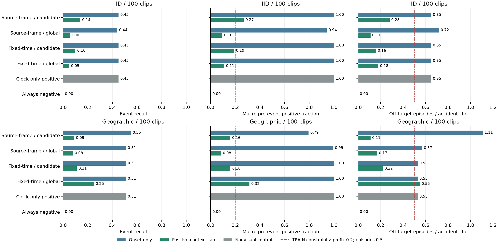

# Positive-Context-Constrained Event Calibration

## Research Question

Can a training-only positive-context constraint prevent the near-always-positive
operating policies admitted by an alert-onset budget, while retaining useful
event recall on a separately declared continuous-replay cohort?

This follow-up retains all eight fitted TCNs and their score functions. It
changes the decision objective, not their architecture, weights, features or
physical-time inference contract. The distinction between score estimation
and operating decisions follows the [ROC analysis foundation](https://doi.org/10.1016/j.patrec.2005.10.010)
and [independent threshold-selection guidance](https://scikit-learn.org/stable/modules/classification_threshold.html).
The numerical budgets below are declared application constraints, not claimed
universal optima from those references.

## Predeclared Objective

Each valid context whose last-frame PTS is strictly earlier than the supplied
event PTS minus one second contributes to the annotation-derived pre-event
population. A clip's positive fraction is the number of these contexts with
score at least the threshold, divided by its eligible context count. The
primary exposure statistic averages these fractions equally across supported
clips, avoiding greater weight for longer clips. Pooled fractions and the
number of clips without eligible contexts accompany it. Unsupported clips
do not receive an invented zero exposure.

Thresholds maximize training-holdout event recall subject to both:

- At most **0.5 off-target alert episodes per accident clip**.
- At most **0.2 macro pre-event positive-context fraction**, with at least
  **20 supported calibration clips**.

The second constraint retains the earlier study's 20% operating-budget level
but defines a different endpoint from its window-FPR calibration. Selection
uses the inherited 0.01-spaced probability grid plus the existing
window-calibrated threshold. Ties favor fewer off-target episodes and then
a higher threshold. Infeasible or insufficient-support policies remain
unselected. There is no test-set search for a replacement default.

These prefixes remain accident-clip annotations. Their context fractions
are not independent normal-camera false-alarm rates or physical alert
durations. Event-level denominators include all declared clips, including
those with no valid inference context.

## Cohort and Execution Freeze

The original 94 IID and 83 geographic training-holdout clips supply all
calibration. Of these, 59 and 40 have eligible pre-event contexts.
Existing calibration features/probabilities are reused under their verified
batch hash; no detector rerun or model fitting is required for selection.

The replay inventory excludes **463 previously processed clip files** before
choosing new event cohorts. Each scheme retains exactly **100 test clips**;
their combined union contains **191 distinct files**. A fixed SHA256 ordering
of seed 42, split name and clip path selects membership without reading model
scores. Available candidate counts before selection are 1,212 IID and 1,251
geographic clips. All prior calibration/test replay identities and supplied
annotation-frame PTS anchors remain traceable.

The follow-up was motivated by the completed onset-budget study. Although
these files have not entered the inventoried continuous event replays, their
paired-window test results were previously observed. The study therefore
evaluates a declared new event-replay endpoint, not a completely untouched
dataset or a retrospective replacement for the original experiment.

The protocol SHA256 is
`3f0fe6e023f92252af49e3bac220715fd73a28be6aea6e4565774f06194a375d`.
Model/source hashes, prior replay inventory, source membership, constraints,
feature implementation and full calibration curves are frozen before replay.
A separate execution appendix binds the new worker/publisher code to the
same protocol and selected thresholds before GPU inference begins.

## Training-Holdout Selections

| Model / split | Threshold | Event recall | Pre-event macro fraction | Off-target / clip |
| --- | ---: | ---: | ---: | ---: |
| Source-frame candidate / IID | 0.84 | 0.117 | 0.186 | 0.202 |
| Source-frame global / IID | 0.78 | 0.117 | 0.144 | 0.117 |
| Source-frame candidate / geographic | 0.99 | 0.036 | 0.191 | 0.084 |
| Source-frame global / geographic | 0.81 | 0.096 | 0.183 | 0.024 |
| Fixed-time candidate / IID | 0.98 | 0.064 | 0.184 | 0.117 |
| Fixed-time global / IID | 0.71 | 0.074 | 0.168 | 0.170 |
| Fixed-time candidate / geographic | 0.99 | 0.084 | 0.153 | 0.036 |
| Fixed-time global / geographic | 0.58 | 0.145 | 0.197 | 0.120 |

All eight training-only settings satisfy both declared constraints. Their
lower calibration recall quantifies the cost of excluding trivial positive
policies; it does not predict a test-set improvement. The new test replay
must report recall and both constraint outcomes together.

## Paired Comparisons

For each model, evaluate the constrained policy and its original onset-only
training-selected threshold on the same new clips. Retain same-grid
clock-only positive and always-negative controls. Report all sixteen policy
outcomes, pre-event support, test constraint exceedance, signed trigger delay
and per-clip outcomes. Eight paired recall contrasts use 2,000 source-clip
bootstrap resamples with seed 42, conditional on the fixed models/selections.
These intervals are pointwise rather than family-wise.

The publisher reproduces the complete calibration curves before reading
test endpoints and recomputes every new checkpoint probability from saved
feature tensors. Invalid cadence contexts receive no prediction, missing hops
reset persistence, and source/decoder mismatches stop publication rather
than changing cohort membership. The 500-clip desktop models and all prior
published measurements remain unchanged.

```powershell
python scripts/prepare_positive_exposure_study.py
python scripts/replay_positive_exposure.py --freeze-execution
python scripts/run_overnight_research.py --phase positive_exposure --deadline 2026-10-17T04:00:00+00:00
python -m pytest tests/test_positive_exposure.py
```

The preparation and replay commands create the frozen study once; completed
queues and immutable publications should not be restarted. Public numerical
verification requires neither videos nor model weights:

```powershell
python scripts/audit_positive_contexts.py
python scripts/plot_positive_contexts.py
python scripts/run_desktop.py --page 1 --tab 6 --screenshot outputs/positive_context.png
```

## Completed Evaluation

All **191 distinct sources** completed without cohort replacement. The
publisher reproduces all **16,568 probabilities** from the saved feature
tensors and eight checkpoints, with maximum absolute error **zero**. Selection
and the execution appendix precede the new test replay in the recorded UTC
chronology. All sixteen operating policies and four constant-control groups
are retained on the fixed 100/100 source cohorts.

| Model / split | Onset recall | Constrained recall | Pre-event macro fraction | Off-target / clip | Both test caps met |
| --- | ---: | ---: | ---: | ---: | :---: |
| Source-frame candidate / IID | 0.45 | 0.14 | 0.268 | 0.28 | No |
| Source-frame global / IID | 0.44 | 0.06 | 0.095 | 0.11 | Yes |
| Source-frame candidate / geographic | 0.55 | 0.09 | 0.160 | 0.11 | Yes |
| Source-frame global / geographic | 0.51 | 0.08 | 0.085 | 0.17 | Yes |
| Fixed-time candidate / IID | 0.45 | 0.10 | 0.191 | 0.16 | Yes |
| Fixed-time global / IID | 0.45 | 0.05 | 0.110 | 0.18 | Yes |
| Fixed-time candidate / geographic | 0.51 | 0.11 | 0.161 | 0.22 | Yes |
| Fixed-time global / geographic | 0.51 | 0.25 | 0.315 | 0.55 | No |

Six of eight constrained policies satisfy both caps on test. Source-frame
candidate IID exceeds the positive-context cap; fixed-time global geographic
exceeds both caps. All eight inherited onset-only policies exceed the episode
budget on this new cohort. Constrained recall ranges from **0.05 to 0.25**,
compared with **0.44 to 0.55** for onset-only decisions. The eight paired
constrained-minus-onset recall differences range from **-46 to -26 percentage
points**, and every pointwise 95% interval is strictly below zero. Off-target
demand falls for seven policies; fixed-time global geographic increases from
0.53 to 0.55. The complete results therefore establish an operating-objective
tradeoff rather than improved event sensitivity.

The same-grid positive control yields recall **0.45 / 0.51**, off-target demand
**0.65 / 0.53** and pre-event positive fraction **1.0 / 1.0**. The always-negative
control has zero recall and zero positive demand. Neither control is a
useful deployable detector: one violates both caps, while the other misses
every annotated event. These measurements use different source cohorts from
the earlier 88/90 study and are not a before/after model-improvement estimate.

Pre-event support is **77/100 IID** and **80/100 geographic** clips, with
159/181 eligible contexts. The remaining 23/20 clips remain in event recall
denominators but do not acquire invented prefix exposure. Invalid contexts
total 48/27 within the respective cohorts; every test clip retains at least
one valid context. Reported delays condition on detected events and should
not be compared as though the detected subsets were unchanged.



## Public Trace Verification

A separate exporter adds **13,060 model-assigned context scores** and a
**1,508-row complete clip inventory** across calibration and test. Empty
contexts, missing prefix support, source hashes, annotation PTS and collision
types remain explicit. The exporter does not modify the frozen publisher or
the scientific protocol.

The independent public-data auditor implements its own hop-gap reset,
two-positive onset gate, inclusive event interval and strict prefix boundary.
It reconstructs **816 calibration-curve points**, all **eight selected
thresholds**, **2,000 per-clip outcomes**, all sixteen model-policy summaries,
four controls, macro/pooled prefix statistics and **eight paired intervals**.
CSV round trips agree within 1e-12. This audit uses public CSV/JSON only,
separately from the publisher's checkpoint/feature verification.

The findings identify limited event sensitivity under the current score-and-
gate contract. Threshold adjustment alone does not establish a useful policy.
Subsequent model development should align training contexts with continuous
inference, examine event-local discrimination using training holdouts, and
evaluate representation changes under a newly frozen protocol. No reference
binary or native operating default is changed using these test outcomes.

[Frozen protocol and replay inventory](results/positive_exposure_protocol.json) ·
[Complete calibration curves and selections](results/positive_exposure_selection.json) ·
[Execution appendix](results/positive_exposure_execution.json) ·
[All policy/control results](results/positive_exposure_results.json) ·
[Per-clip outcomes](results/positive_exposure_outcomes.csv) ·
[Context trace manifest](results/positive_context_trace.json) ·
[Independent public-data audit](results/positive_context_audit.json).
