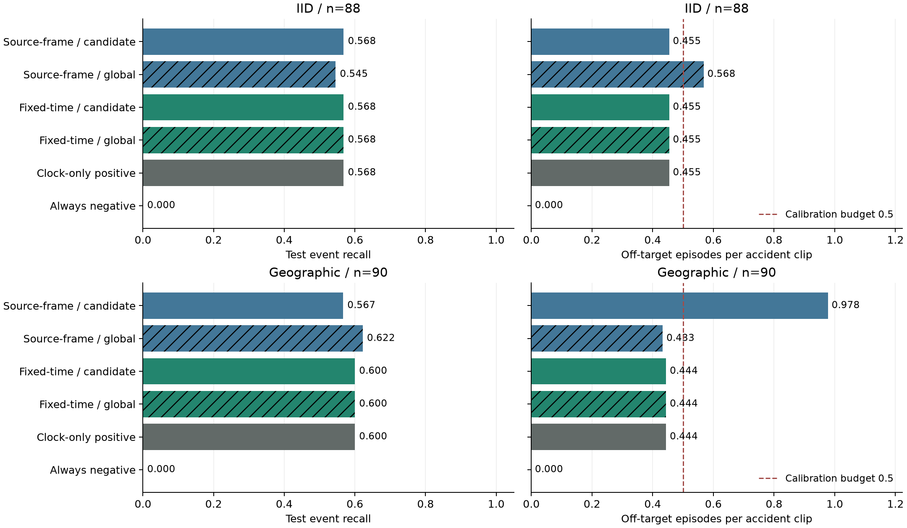
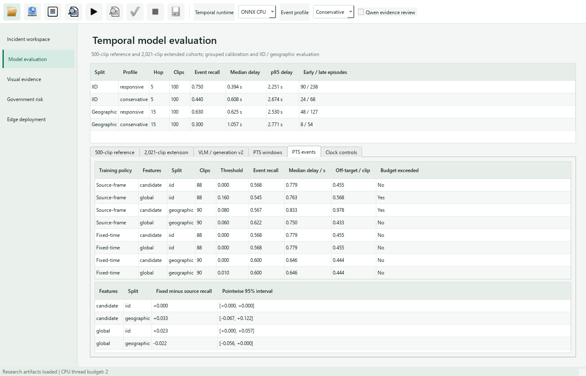
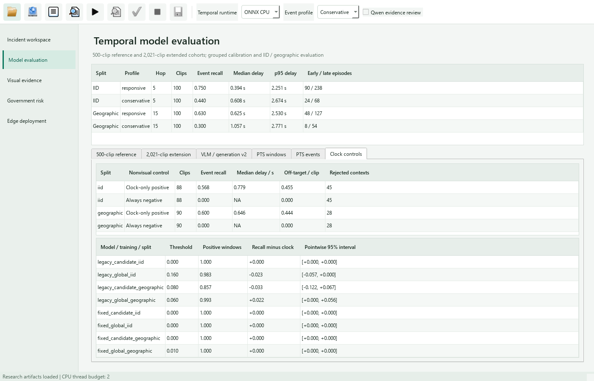

# Continuous Presentation-Time Event Evaluation

## Objective

Determine whether the matched training policies transfer to continuous
incident recognition under a common physical-time input and alert budget.
All eight candidate/global, source-frame/fixed-time, IID/geographic TCNs
remain in the study regardless of their preceding window-level outcomes.
The original 500-clip desktop binaries and operating defaults are unchanged.

## Frozen Contracts

The parent study defines 94 IID and 83 geographic training-holdout clips,
and test intersections of 88 and 90 clips. Membership is fixed before this
replay, with no replacements. Each split calibrates only on its own training
holdout. The machine-readable event protocol binds source/video hashes,
annotation anchors, model hashes, code hashes, decoder/runtime versions,
and the parent paired-cohort specification before event inference starts.

All models use the same globally phased 7.5-Hz target grid, normalized to
the first presentation timestamp. Each 16-image context yields 15 motion
steps; successive contexts begin 15 target slots apart. Inputs retain a
320-pixel width limit, detector image size 320 and confidence 0.15. Tracking
resets within each context, matching the training extractor. This is a
rolling-context inference contract, distinct from persistent per-camera
tracking in the existing native reference pipeline.

Packet timestamps are obtained with the pinned FFprobe executable, using
its [structured packet/stream output](https://ffmpeg.org/ffprobe.html).
The selected full-clip grid is decoded sequentially from the source origin;
every selected frame must agree with frame identity and presentation time
within 0.1 ms. The supplied annotation frame maps to its previously verified
PTS. Annotation time is not provided to detector or feature extraction.

Duplicate-frame or excessive-lateness contexts produce no prediction.
Persistence resets across any missing hop. No frames are interpolated,
no invalid contexts are scored as normal, and no clip is replaced. A clip
without any valid context remains in the event denominator as a miss;
source integrity or decoder verification failures stop publication for
investigation rather than silently removing the clip.

## Calibration and Endpoints

Two consecutive valid positive contexts emit an episode at the second
context's actual last-frame PTS. Sustained positives are one episode;
a negative context or missing hop terminates its persistence state.
Events match episode starts within [-1, +3] s of the supplied annotation
frame's PTS. Delay is signed trigger PTS minus annotation PTS and is
summarized among detected clips, with misses reported separately.

The threshold grid and selection rule are inherited from the parent
pre-fitting plan: maximize training-holdout event recall subject to at
most 0.5 off-target episodes per accident clip; ties favor fewer off-target
episodes, then a higher threshold. Infeasible settings remain unselected.
The existing window-calibrated threshold is also included in the grid.
All eight selections must be recorded and hash-bound before test replay.
At publication, they must reproduce exactly from their calibration inputs.

Report all eight event recalls, delay distributions, rejected contexts,
off-target demand and test budget exceedance. Four fixed-minus-source-frame
recall contrasts use 2,000 paired source-clip bootstrap resamples, seed 42.
Intervals are pointwise and conditional on the fitted models and selected
thresholds; neither refitting nor selection uncertainty is resampled.
Off-target demand in accident clips is not a reviewed-normal camera-hour
false-alarm estimate. Source-time delay is distinct from compute latency.

## Execution

```powershell
python scripts/prepare_presentation_event_protocol.py
python scripts/run_overnight_research.py --phase pts_events --deadline 2026-10-17T04:00:00+00:00
python -m pytest tests/test_presentation_events.py
```

The separate queue replays calibration inputs, freezes operating thresholds,
replays test inputs, and publishes verified comparison JSON/CSV. It runs only
after the cadence training queue has completed, under the same exclusive
GPU lock and two-thread worker limit. Per-clip artifacts support resumption;
the runner terminates the complete worker process tree at its deadline.

CPU verification covers source-clock causality, missing-hop resets, invalid
and empty contexts, event-boundary matching, model-specific calibration
membership, cohort completeness and changed artifact hashes. A real-detector
CPU check on the training-only clip `xKT7khciy-c_2_00.mp4` yields one finite
15-by-14 feature tensor and a context ending at PTS 2.035367 s. This check
does not contribute to model fitting or reported test performance.

The frozen event protocol SHA256 is
`f8725a5e20f5d6ac04c55f15b37e88f8e2ae8555eb3599f8ed903768ab77b131`.
Its combined calibration/test source union contains 318 distinct clips.
A separate end-to-end CPU smoke replay loads all eight actual checkpoints
and records one valid context on a calibration clip; its smoke flag bars it
from complete-cohort publication. The complete 408-test regression suite
passes before starting the new GPU queue.

[Frozen model, source and implementation hashes](results/presentation_event_protocol.json).

## Execution Amendments

All 170 distinct calibration-source replays complete before operating-point
selection. The original reporter exposes NumPy integer episode counts that
the standard JSON encoder cannot serialize. The
[format-only amendment](results/presentation_event_serialization.json)
binds the unchanged calibration batch, protocol and reporting implementation
to a reporter-local scalar encoder. It converts NumPy scalars to identical
Python scalars without changing probabilities, numerical endpoints or the
selection rule. Original failure logs and runner status are preserved; the
completed GPU calibration batch is reused rather than recomputed.

After calibration, four models select threshold zero under the declared
episode budget. A separate [diagnostic control specification](results/presentation_event_controls_protocol.json)
is therefore frozen before test replay. It evaluates always-positive and
always-negative contexts on the same valid source grid, with identical
persistence and missing-hop resets. The positive control needs no images
or model scores: it tests how event placement and sequence warm-up affect
recall. These controls are a calibration-motivated diagnostic addition, not
part of the original pre-fitting model comparison.

The control audit also recomputes every saved checkpoint probability from
the hash-bound per-clip feature tensors, with absolute tolerance 1e-7.
All eight model-minus-clock recall contrasts are reported, with pointwise
paired source-clip intervals and the fraction of positive context decisions.
Zero-threshold models must agree exactly with the clock-only positive control.

The benchmark's [official naive baseline](https://github.com/accidentbench/ACCIDENT/blob/main/baselines/heuristic/naive.py)
also evaluates nonvisual timing priors, including a clip-midpoint prediction
and an explicitly oracle-aided median. The present clock control differs:
it requires neither final clip duration nor a fitted event-time median and
can emit only after a complete eligible persistence context has arrived.
It is a causal warm-up control, not a reproduction of the midpoint baseline.

Public per-clip calibration/test outcome traces preserve source hashes,
annotation PTS, selected thresholds, matched/missed events, signed delays,
rejected contexts and early/late episodes for every model and both controls.
Undefined delays remain empty rather than being replaced with zero.

```powershell
python scripts/run_presentation_event_reporting.py calibrate
python scripts/run_overnight_research.py --phase pts_events --deadline 2026-10-17T04:00:00+00:00
python scripts/audit_presentation_event_predictions.py publish
python scripts/publish_presentation_event_trace.py
python scripts/plot_presentation_events.py
```

## Completed Event Results

Calibration replays 170 distinct sources and testing replays 169, with a
318-source union across the two official split schemes. Model-specific
calibration/test memberships remain 94/88 IID and 83/90 geographic clips.
The complete queue finishes on 16 October 2026. Recomputing all 21,608 saved
probabilities from checkpoint weights and per-clip features gives maximum
absolute error zero: 8,744 calibration and 12,864 test probabilities.

| Training / features | Split | Threshold | Event recall | Median delay, s | Off-target / clip | Budget exceeded |
| --- | --- | ---: | ---: | ---: | ---: | --- |
| Source-frame / candidate | IID | 0.00 | 0.568 | 0.779 | 0.455 | No |
| Source-frame / global | IID | 0.16 | 0.545 | 0.763 | 0.568 | Yes |
| Fixed-time / candidate | IID | 0.00 | 0.568 | 0.779 | 0.455 | No |
| Fixed-time / global | IID | 0.00 | 0.568 | 0.779 | 0.455 | No |
| Source-frame / candidate | Geographic | 0.08 | 0.567 | 0.833 | 0.978 | Yes |
| Source-frame / global | Geographic | 0.06 | 0.622 | 0.750 | 0.433 | No |
| Fixed-time / candidate | Geographic | 0.00 | 0.600 | 0.646 | 0.444 | No |
| Fixed-time / global | Geographic | 0.01 | 0.600 | 0.646 | 0.444 | No |

The clock-only positive control reaches recall 0.568/0.600 and off-target
demand 0.455/0.444 for IID/geographic testing, respectively. Four selected
zero-threshold models reproduce it exactly. The fixed-time geographic global
model also labels every valid test context positive at threshold 0.01 and
reproduces its event outcomes. Neither control introduces visual evidence.

The source-frame geographic global model exceeds the clock control by
2.22 pp [0.00, 5.56], while source-frame geographic candidate differs by
-3.33 pp [-12.25, 6.67]. Source-frame IID global differs by -2.27 pp
[-5.68, 0.00]. No model-minus-clock pointwise interval lies strictly above
zero. These findings do not establish a positive visual contribution under
this episode-budget operating rule; they suggest sensitivity to event-time
placement and persistence warm-up in the accident-clip cohort.

The episode budget constrains alert onsets rather than the fraction or
duration of positive contexts. A sustained positive sequence can therefore
emit few episodes while accepting nearly every context. All models accept
between 85.7% and 100% of valid test contexts at their selected thresholds.
Future operating-point studies should additionally constrain pre-event
positive exposure, then validate on independent continuous normal sessions
and newly declared event cohorts. The current outcomes and desktop reference
defaults remain unchanged.

Testing rejects 45 IID and 28 geographic contexts under the predeclared
cadence/lateness rule; all test clips retain at least one valid context.
One geographic calibration clip has no valid contexts and remains a miss
in its fixed denominator. Two of eight test policies exceed their 0.5
episode calibration budget. Delay summaries condition on detected clips;
they do not count misses as zero delay or measure hardware service time.



[Eight-model results and paired recall intervals](results/presentation_event_comparison.json) ·
[Full training-only curves and selections](results/presentation_event_selection.json) ·
[Nonvisual controls and prediction verification](results/presentation_event_controls.json) ·
[2,130 public per-clip outcomes](results/presentation_event_outcomes.csv) ·
[Trace provenance](results/presentation_event_outcomes.json).

The native workbench presents PTS window, event and clock-control tables in
separate tabs, preserving the original benchmark profiles and their clocks.



