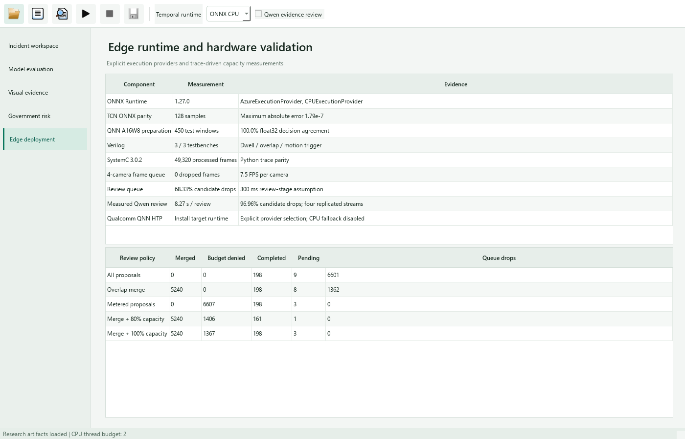

# Capacity-Aware Multimodal Evidence Routing

## Research Question

Can causal proposal coalescing and service-aware admission control reduce
uncontrolled review-queue loss under a measured VLM service budget?

The design follows the separation between early video filtering and expensive
downstream analytics discussed in [Reducto, SIGCOMM 2020](https://www.cs.princeton.edu/~ravian/publications/reducto_sigcomm20.pdf).
Admission uses the strict token-bucket model described in
[RFC 3290, Appendix A](https://www.rfc-editor.org/rfc/rfc3290.html#appendix-A).
The implementation adapts these established ideas to candidate evidence;
it does not reproduce Reducto's learned frame-filter configuration.

## Protocol

The workload contains 12,330 model-produced candidate records, replicated
across four camera streams at a nominal 7.5 FPS. These records concatenate
sampled ACCIDENT windows. Their arrival density defines a capacity experiment,
while incident recall and continuous-camera exposure have separate evaluations.

Proposal eligibility requires availability and score at least 0.95. Causal
coalescing retains the first proposal and merges later overlapping candidates
within 15 replay steps at IoU at least 0.1. It resets at source-file or frame
discontinuities. Routing does not read event labels or accident annotations.

The shared meter refills at 80% or 100% of one review per 8.27361 seconds,
the mean of the controlled Qwen experiment. Burst capacity is four requests.
Rotating camera priority prevents a synchronized camera from monopolizing
available credits. The downstream queue has eight waiting positions. Detector
and temporal service times remain configured at 3.9 and 3.0 ms, respectively.

Every raw proposal belongs to exactly one accounting category: coalesced,
budget-denied, completed, pending, or queue-dropped. Budget-denied candidates
are not classified as completed evidence or successful incident detections.

## Results

Each policy processes 49,320 frames without front-end loss.

| Policy | Coalesced | Budget denied | Completed | Pending | Queue drops |
| --- | ---: | ---: | ---: | ---: | ---: |
| All proposals | 0 | 0 | 198 | 9 | 6,601 |
| Overlap merge | 5,240 | 0 | 198 | 8 | 1,362 |
| Metered proposals | 0 | 6,607 | 198 | 3 | 0 |
| Merge + 80% capacity | 5,240 | 1,406 | 161 | 1 | 0 |
| Merge + 100% capacity | 5,240 | 1,367 | 198 | 3 | 0 |

Overlap coalescing consolidates 76.97% of raw proposal arrivals but does not
resolve the remaining service deficit. At full measured capacity, metering
retains 198 completed reviews, reduces pending work from nine to three, and
replaces overflow with explicit admission decisions. Per-camera admissions are
51/50/50/50. The 80% profile leaves service headroom and completes 161 reviews.

All eight integer counters agree between Python and SystemC 3.0.2 for all five
policies. Finite frame-count generation avoids an additional terminal arrival
batch caused by simulation-time rounding. The native application displays the
same numerical artifact.



## Reproduction

On Windows with Visual Studio 2022 C++ Build Tools, CMake, and Git:

```powershell
powershell -NoProfile -ExecutionPolicy Bypass -File scripts/build_systemc_windows.ps1
python scripts/evaluate_review_routing.py --systemc-executable outputs/toolchain/traffic-systemc-msvc-build/Release/npu_queue_sim.exe
python -m pytest tests/test_review_routing.py tests/test_systemc_review_replay.py
```

The build script verifies the official SystemC 3.0.2 release commit, limits
parallel compilation to two jobs, and removes its temporary drive alias on
exit. The result records trace, review-report, executable, and simulator-source
hashes. Existing CMake targets also support other SystemC installations.

[Numerical artifact](results/review_routing.json)

## Subsequent Evaluation

Measure event retention after routing using independent incident labels,
normal-stream exposure, variable service times, and heterogeneous camera
arrivals. Government risk can inform resource allocation, with minimum camera
service guarantees evaluated alongside risk-weighted prioritization.
