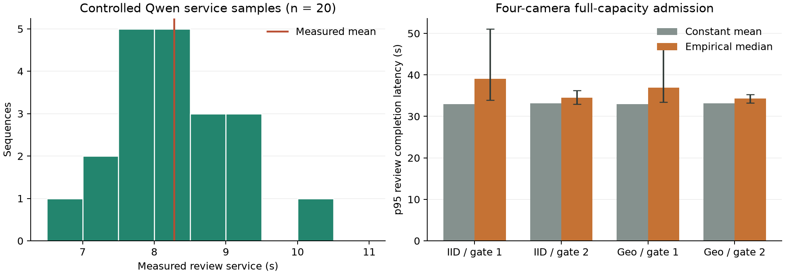

# Heterogeneous Multimodal Review Service

## Experimental Design

The controlled three-frame Qwen experiment provides 20 measured review
durations, with mean 8.274 s, sample standard deviation 0.830 s, and range
6.901--10.324 s. A trace-bound sensitivity study compares constant mean service
with independent empirical draws from these durations. Each of ten assignments
uses a fixed seed (42--51); source-frame indexing shares assigned service
across routing policies. Within a policy, candidate admission remains fixed
between constant and variable service. This isolates downstream variability
rather than reoptimizing the admission rate for each realized trace.

The study retains the original 100-clip IID and geographic workloads, their
respective five/15-step hops, one/two-window persistence, one/four cameras,
and all-episode/full-capacity-meter admission. Sixteen conditions and eleven
service assignments produce 176 scenarios. Empirical assignment ranges are
sensitivity ranges, not population confidence intervals. The twenty service
samples do not identify scene-dependent service distributions or correlations
between service cost and event difficulty.

The shared front end retains configured detector/temporal costs of 3.9/3.0 ms.
These are scenario parameters, separate from measured local VLM service and
from target-device profiling. Event retention measures completion of a review
for a matching temporal episode, not VLM classification correctness.

## Results

Selected four-camera, full-capacity admission results:

| Split | Gate | Constant p95 (s) | Empirical median p95 (s) | Assignment range (s) | Completed matched events, constant / median |
| --- | ---: | ---: | ---: | --- | ---: |
| IID | 1 | 32.96 | 39.06 | 33.96--51.09 | 62 / 62 |
| IID | 2 | 33.10 | 34.34 | 33.27--35.23 | 69 / 69 |
| Geographic | 1 | 32.95 | 36.91 | 33.44--46.96 | 78 / 78 |
| Geographic | 2 | 33.10 | 34.34 | 33.27--35.23 | 69 / 69 |

Constant-mean service understates tail latency in these metered conditions.
Matched event completion remains unchanged across the ten assignments here;
this stability does not extend to every unmetered condition. For example,
single-camera responsive IID replay changes from 45 matched completions to
a median of 52 (range 47--56), while its p95 review latency increases from
74.14 to 76.23 s. Fixed FIFO admission, overflow, and service assignment jointly
determine which event identities survive. Immediate edge notification remains
separate from this evidence-service completion endpoint.



## Cross-Language Verification

The constant and first empirical assignment are independently replayed in
SystemC for all 16 conditions. All eight integer counters agree in 32 checks.
The simulator specifies completion-before-arrival ordering at equal times,
includes endpoint completions, and uses positive half-up frame counts.
Regression cases cover an idle consumer with a one-position FIFO, simultaneous
review completion/admission, and non-integer frame-count rounding. Historical
constant-service artifacts retain their original executable hashes; the new
study records its current source and executable hashes separately.

[Complete scenario results and provenance](results/review_service_variability.json)

```powershell
python scripts/evaluate_review_service_variability.py --systemc-executable outputs/toolchain/traffic-systemc-msvc-build/Release/npu_queue_sim.exe
python scripts/plot_review_service_variability.py
python -m pytest tests/test_npu_queue_model.py tests/test_systemc_review_replay.py
```
