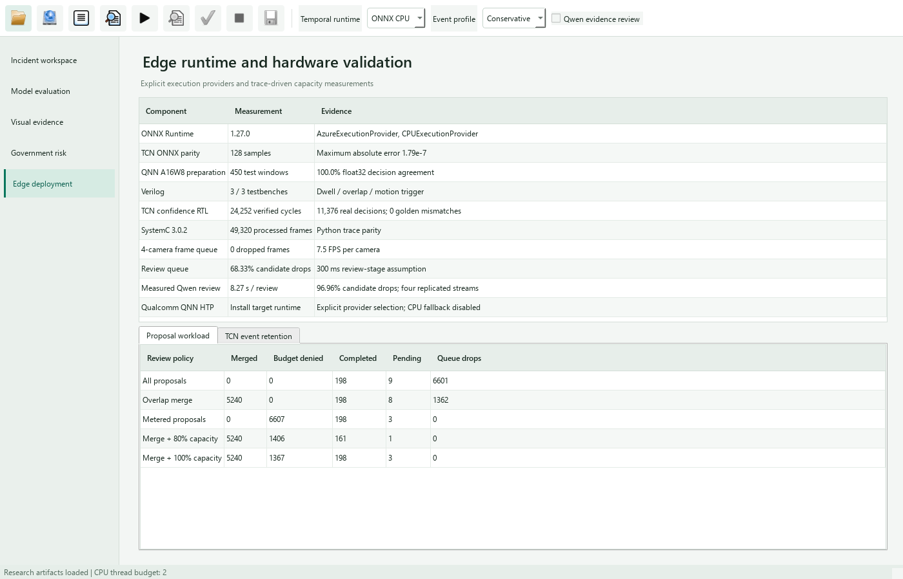

# Real-Trace Confidence Controller Verification

## Architecture

The post-inference controller consumes a 16-bit confidence value and a
16-bit operating threshold. Its two-bit saturating state records zero,
one or at least two consecutive positive decisions. The second positive
decision emits one episode pulse; subsequent positives retain the review
flag without emitting duplicate pulses. A negative decision re-arms the
controller. Explicit context resets clear persistence at clip boundaries
and missing source hops. Idle compute cycles hold state and emit no pulse;
they are distinct from missing source observations.

The Verilog module uses registered outputs and asynchronous active-low
reset. A synchronous context reset has priority over a simultaneous valid
decision. This deterministic interface separates immediate event notification
from downstream VLM admission and review queues. It implements decision
control, while the existing SystemC model addresses shared inference and
review-resource contention.

## Quantization Contract

Confidence and threshold use endpoint-preserving UNORM16 encoding:
`floor(value * 65535 + 0.5)`. Reconstructed values divide the code by 65535;
the nearest-code error is bounded by `0.5/65535`, approximately 7.63e-6.
This representation is not a signed fixed-point or QNN activation format.

Quantizing confidence and threshold independently can change a comparison
near a threshold. Tests explicitly demonstrate such a counterexample and
exercise exact equality, codes zero/65535, idle cycles, reset priority and
persistence saturation. Real-trace results separately report raw-positive,
review-flag, episode-pulse, matched-event and trigger-time changes relative
to the original floating-point policy.

## Measured Verification

The frozen PTS experiment supplies all eight models, both official split
schemes and calibration/test cohorts. Its training-selected thresholds and
actual source presentation clocks remain unchanged. The trace contains
**11,376 model decisions across 1,420 model/clip/cohort runs**, including
empty-context runs that contribute only a reset. Reset and idle tokens
expand this to **24,252 checked controller cycles**.

Icarus Verilog 12.0 executes the self-checking testbench against every token.
All review flags, episode pulses and saturating states match the Python
integer golden model. The observed maximum confidence reconstruction error
is **7.62921e-6**. No raw-positive decision, review flag, episode onset,
matched-event outcome or source-time trigger changes in this corpus.
The independent randomized test verifies 2,000 additional cycles, including
threshold equality and reset/valid coincidences.

The real-data result characterizes these confidence streams, not arbitrary
threshold margins. Simulator time steps describe testbench stimuli; FPGA/ASIC
clock limits, resource utilization and power require synthesis and target
measurement. Snapdragon NPU arithmetic remains a separate deployment task.

The simulator's Verilog string file interface rejects an absolute vector
path containing the workspace's non-ASCII characters. Runtime arguments
therefore use repository-relative ASCII paths with an explicit working
directory. A Unicode-directory regression verifies this launch contract.
Partial vectors are reused only when their bytes match regenerated stimuli.

## Reproduction

```powershell
python scripts/verify_tcn_confidence_rtl.py
python -m pytest tests/test_tcn_confidence_rtl.py
```

Completed public results are immutable. The publisher records source/model
study hashes, compiler/runtime hashes, implementation hashes, vector/CSV
hashes and the complete simulator response. The compact vector file can be
replayed without downloading image data or loading an AI model:

```powershell
C:/iverilog/bin/iverilog.exe -g2012 -s tcn_confidence_gate_tb -o outputs/hardware/tcn_confidence_gate.vvp hardware_sim/rtl/tcn_confidence_gate.v hardware_sim/testbench/tcn_confidence_gate_tb.v
C:/iverilog/bin/vvp.exe outputs/hardware/tcn_confidence_gate.vvp +vectors=hardware_sim/test_vectors/tcn_confidence_real.txt
```

[Verification report](results/tcn_confidence_rtl.json) ·
[Per-decision float/integer audit](results/tcn_confidence_rtl_trace.csv) ·
[Real model stimuli and expected outputs](../hardware_sim/test_vectors/tcn_confidence_real.txt).


