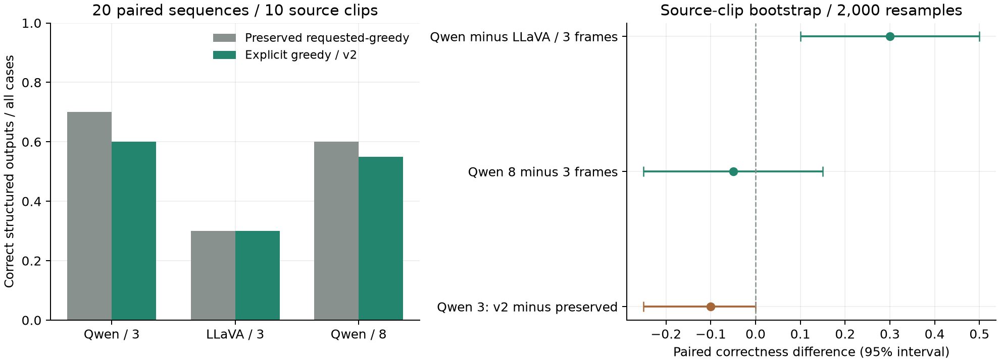
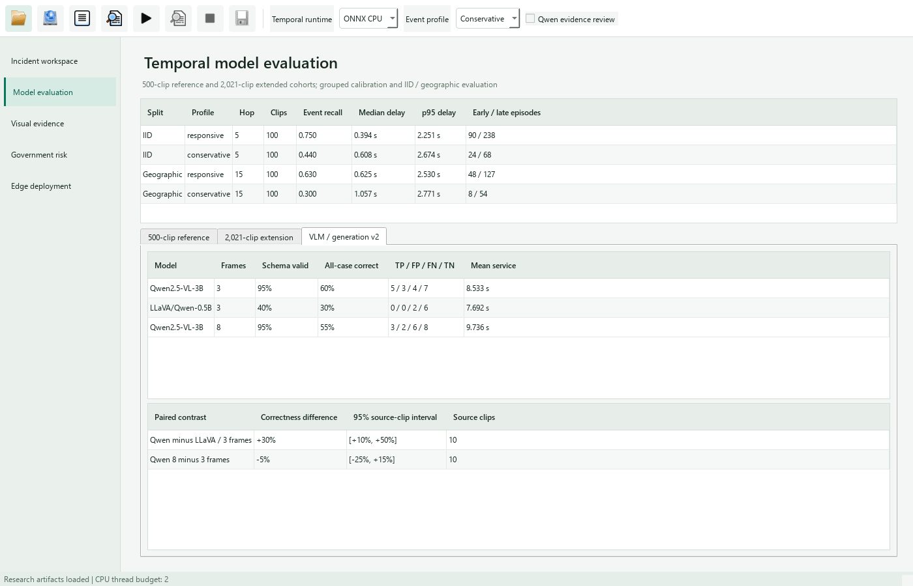

# Multimodal Generation-Parameter Contract

## Runtime Audit

The installed Transformers 5.13.0 image-text-to-text pipeline separates
preprocessing arguments from `generate_kwargs`. Its `_sanitize_parameters`
routes a top-level `do_sample` argument to the processor, whereas nested
`generate_kwargs["do_sample"]` reaches model generation. The previous wrapper
requested `do_sample=False` at the top level. Its legacy result metadata records
the requested setting, not a verified effective decoding override.

The cached Qwen revision `66285546d2b821cf421d4f5eb2576359d3770cd3`
specifies `do_sample=true` and temperature 0.000001 in `generation_config.json`.
This very low temperature does not establish an enforced greedy contract.
The LLaVA revision has a separate default configuration. Therefore the earlier
paired comparison must not be interpreted as a verified common greedy decoder.
Measured responses, schema outcomes, and elapsed times remain unchanged.

## Corrected Execution

[Installed sanitizer, wrapper and cached-configuration hashes](results/vlm_generation_contract.json)

Generation contract version 2 forwards both `do_sample=False` and the token
budget through `generate_kwargs`. A regression test invokes the installed
pipeline's actual sanitizer and verifies that decoding is absent from the
processor arguments and present in the generation arguments. Unit tests also
verify the wrapper call and saved-event provenance.

The corrected three/eight-frame experiments reuse every original request and
image. Model revisions are pinned to the previous measured revisions. Separate
`*_forwarded_v2_result.json` case files and `*_forwarded_v2_batch.json` summaries
preserve legacy results. Cache signatures include the wrapper hash, generation
contract version, Transformers version, request, images, model revision, and
token budget. Initial, representation, resolution, and calibration queues are
not restarted; a separate `decoding` queue contains only these replications.

The earlier queue and variable-service studies retain their observed service
samples. They describe those measured workloads rather than the service
distribution of the corrected decoder. Likewise, evidence-aware policy
reanalysis remains tied to its original hashed responses; corrected responses
and their disposition counts are reported separately below.

## Corrected Paired Results

All three version-2 replications completed on the original twenty sequences
from ten source clips. Models receive matched privacy-treated imagery, the
collision-specific prompt, BF16 execution, and a 192-token budget. Input and
result hashes reproduce the published summaries.

| Model | Frames | Schema validity | All-case structured correctness | TP / FP / FN / TN | Mean service (s) |
| --- | ---: | ---: | ---: | --- | ---: |
| Qwen2.5-VL-3B | 3 | 95% | 60% | 5 / 3 / 4 / 7 | 8.533 |
| LLaVA/Qwen-0.5B | 3 | 40% | 30% | 0 / 0 / 2 / 6 | 7.692 |
| Qwen2.5-VL-3B | 8 | 95% | 55% | 3 / 2 / 6 / 8 | 9.736 |

Confusion counts include schema-valid responses; the correctness denominator
includes all twenty cases. Qwen minus LLaVA is +30 percentage points, with a
paired source-clip bootstrap 95% interval of +10 to +50 points. The eight-minus-
three-frame contrast is -5 points (-25 to +15). Additional frames increase
mean service time by 1.203 s (14.1%) without establishing improved correctness
on this cohort. Model sizes differ, so this comparison does not isolate an
architecture effect or establish performance at equal model capacity.

Relative to the preserved requested-greedy run, Qwen three-frame correctness
changes by -10 points (-25 to 0); LLaVA's all-case outcomes are unchanged.
This is an implementation-contract replication, not a search for a better
test result. Neither new response files nor summaries replace the legacy
service workloads or their measured queue results.

The version-2 three-frame Qwen disposition counts are eight incomplete-evidence,
eleven temporal/visual disagreement, and one response-contract review. No case
passes the complete-evidence support gate; supported-case precision remains
undefined. VLM descriptions remain model outputs rather than ground truth.



[Verified comparison and case hashes](results/vlm_forwarded_comparison.json) ·
[Qwen three-frame summary](results/incident_vlm_qwen_forwarded_v2_batch.json) ·
[LLaVA summary](results/incident_vlm_llava_forwarded_v2_batch.json) ·
[Qwen eight-frame summary](results/incident_vlm_qwen_dense8_forwarded_v2_batch.json)



```powershell
python -m pytest tests/test_vlm_transformers.py tests/test_incident_review_service.py
python scripts/audit_vlm_generation_contract.py
python scripts/run_overnight_research.py --phase decoding --deadline 2026-10-17T04:00:00+00:00
python scripts/publish_vlm_forwarded_comparison.py
python scripts/plot_vlm_forwarded_comparison.py
```

The comparison publisher verifies case hashes, reconstructed input signatures,
manifest identity, labels, confusion counts, correctness, and service means.
It reports paired all-case correctness differences using 2,000 source-clip
bootstrap resamples (seed 42), retaining both sequences of a sampled clip
together. The ten source clips, not the twenty sequences, are the independent
resampling units. Invalid structured responses count as incorrect; legacy
versus corrected runs and three/eight-frame comparisons remain separate.

Implementation reference: the installed `transformers/pipelines/image_text_to_text.py`
and [primary pipeline source](https://github.com/huggingface/transformers/blob/main/src/transformers/pipelines/image_text_to_text.py).
